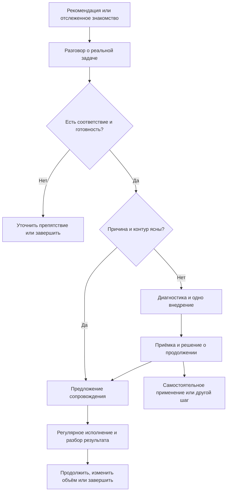

# Воронка агентства для химчисток одежды

Навигация: [ниша](../../_index.md) → [паспорт JTBD](_index.md) → [сегменты](segments/_index.md). Детализация AARRR рабочего сегмента находится [в его папке](segments/replace-marketer/_index.md). Этот файл хранит общие вводные и обзор OPF, а не заменяет сегментные этапы.

**Основа:** [маршрут OPF](../../../../../marketing-os/routes/one-product-flow/_index.md). Сначала текущая ситуация и проблемы покупателя, затем сегменты, предложение, источник и тест.

**Правило этой сборки — прямое указание Володи:** ничего не придумывать; недостающие сведения выяснять вопросами. Гипотезы и предложения не выдаются за подтверждённые характеристики аудитории. Предыдущие предложения ассистента о первом источнике и узком сегменте не приняты за основу.

## Результат подробного исследования

Собран кабинетный разбор РФ, США, Великобритании, Канады и Австралии; собственных новых интервью и продаж в рамках исследования не проводилось. Зарубежные компании не объявляются эквивалентными обороту 2–10 млн ₽/месяц. Ниже — проект решений для проверки, а не утверждённая рабочая воронка.

| Документ | Что в нём |
|---|---|
| [Источники и ограничения](../../research/sources.md) | Собственные материалы, исследования SMB и отрасли, публичные эпизоды, поставщики и методы; проверка дублей и ненадёжных страниц |
| [Досье ниши](../../research/niche.md) | Устройство бизнеса, карта причин недостатка клиентов, покупатель услуги, альтернативы агентству, конкуренты, перенос между странами и границы оценки рынка |
| [JTBD](../../research/job-map.md) | Шесть аналитических работ, предлагаемый стартовый сегмент, четыре силы, критерии выбора и неизвестные |
| [Money Models и экономика](money-model.md) | Экономика клиента и агентства, последовательность предложений, зачёт входа, сценарии расходов и мощности, CAC и удержание |
| [Оффер и исполнение](offer.md) | Уравнение ценности, проблемы до/во время/после покупки, вход, роль пакетов, приёмка и границы «под ключ» |
| [Проверка и вопросы](validation.md) | Разбор пяти реальных ситуаций без выдуманных аватаров, 31 вопрос об опыте, проверка концепции и коммерческие метрики |

**Рабочий вывод:** проверять передачу согласованного маркетингового контура одной команде у действующей сети, которая замечает недостаток клиентов. Сначала различить привлечение, повторы, приёмку и мощность; затем выбирать продукт и источники. Сам перечень каналов не даёт доказанного отличия — отраслевые поставщики уже предлагают комплексное исполнение.

**Главные развилки:** причина падения у каждого клиента; пригодность учёта; минимальная комплектация сети; реальная покупка новой линейки; часы и себестоимость исполнения, предел одновременно сопровождаемого портфеля. Общий бюджет уточнён ниже, роли и заявленный темп запуска → [контур команды](../../../../../team/_agency.md#контур-химчисток-одежды). Прайсы и предложенные лимиты не подтверждают экономику.

## S1. Подтверждённые вводные

Источник этого раздела — ответы Володи в диалоге 2026-11-10. Это его описание опыта с двумя клиентами, а не дословные интервью собственников и не исследование всей ниши.

### Почему пришли действующие клиенты

По словам Володи, Стиралкин и UNISEC пришли с таким запросом:

- Клиентов стало меньше.
- Конкуренты активизировались.
- Собственники решили, что пора заниматься маркетингом.
- В маркетинге сами не разбираются.
- Хотят комплексно передать эту задачу одному ответственному исполнителю.
- Найм отдельного директолога не закрывает их запрос: нужен человек или команда, которые сделают маркетинг под ключ.

Опорная формулировка Володи: «им важен человек, который под ключ это сделает».

Это причины обращения в пересказе владельца агентства. Размер и период снижения числа клиентов, конкретные действия конкурентов и детальные результаты предыдущих попыток решения пока не установлены. Не утверждаем, что снижение вызвано именно маркетингом.

Уточнение по предыдущему исполнителю, выбору агентства и большой цели Стиралкина → [история покупки](../../../../../clients/stiralkin/_index.md#история-выбора-агентства), источник О05. Для этого клиента часть критериев выбора теперь известна; для UNISEC прежний способ и конкретные основания выбора остаются неустановленными. Детальные результаты прежнего специалиста, измерение цели, срок и сомнения до оплаты не раскрыты.

### Кого Володя хочет привлекать

| Параметр | Подтверждено |
|---|---|
| Ниша | Химчистка одежды |
| Размер сети | 2–3 приёмных пункта и более |
| Оборот | От примерно 2 млн ₽ в месяц; для расширенного исследования Володя подтвердил диапазон 2–10 млн ₽/месяц |
| Возможности бюджета | По уточнению Володи — 10–15% оборота на всё: агентская оплата, рекламные расходы и платные сервисы. Это вводная целевого профиля; бюджет каждого покупателя подтверждается отдельно |
| Целевое число клиентов | 20 химчисток |
| Географический ориентир | 20 крупнейших городов; конкретный список не выбран |

Не установлены обязательность собственного цеха, верхняя граница размера сети, возможность работать с несколькими компаниями в одном городе и требования к учёту заказов. Цель «20 клиентов / 20 городов» не трактуется как обещание городского эксклюзива.

### Как действующие клиенты нашли агентство

Володя назвал рекомендации, соцсети, контент и посещение выставок. Планирует продолжать привлечение этими способами. Какой путь был у каждого из двух клиентов, что дало первое знакомство и что привело к оплате — пока не разделено.

Один источник для первого измеримого потока ещё не выбран. Предложенные ранее ассистентом персональные обращения не считаются согласованным каналом.

**Маршрут первого обращения — решение Володи 2026-11-10:** из ролика или публикации вести собственника в личный Telegram Володи. Это выбор для проектируемой воронки, а не восстановленный способ обращения Стиралкина. Адреса личного Telegram и контентного канала подтверждены 2026-11-11 и принадлежат [Acquisition](segments/replace-marketer/funnels/content-city-review/acquisition.md#адреса-площадок); польза описана в [Activation](segments/replace-marketer/funnels/content-city-review/activation.md), проект приглашения — в [контентном материале](segments/replace-marketer/funnels/content-city-review/acquisition-content.md).

### Практика контента и пользы до оплаты

**Источник:** ответы Володи 2026-11-10, описание своей практики, не новый опрос покупателей.

- На канале АГБИС было «пару эфиров про маркетинг». Темы отдельных эфиров, ссылки, даты и состав аудитории не уточнены; какой материал видел Стиралкин, неизвестно.
- На вопрос о пользе до оплаты Володя назвал «разбор ситуации в городе». Его состав, результат и [уточнённые условия входа в город и связи со стратегией](segments/replace-marketer/funnels/content-city-review/activation.md#условия-городского-разбора) принадлежат Activation рабочего сегмента. Не установлено, получал ли именно такой разбор Стиралкин.

Применение к текущему сегменту → [Acquisition](segments/replace-marketer/funnels/content-city-review/acquisition.md), [Activation](segments/replace-marketer/funnels/content-city-review/activation.md). Названная практика не заменяется автоматически полным платным аудитом из ценовой гипотезы.

### Продукт и исполнение

Согласованные ценовые ориентиры и предложенный состав пакетов принадлежат [HYP-TRF-003](../../../../hypotheses.md#химчистка-одежды-состав-на-проверку-от-2026-11-10). Работы в пакетных проектах выполняет внутренняя команда агентства.

Конкретные роли и заявленный темп новых запусков → [контур химчисток одежды](../../../../../team/_agency.md#контур-химчисток-одежды). Назначение ролей не подтверждает себестоимость, свободные часы и возможность вести целевой портфель без личного исполнения Володи.

**Предлагаемый основной путь — прямая продажа месячного сопровождения.** В О05 установлена первая покупка именно такого формата; детали → [история Стиралкина](../../../../../clients/stiralkin/_index.md#история-выбора-агентства). Один эпизод не подтверждает конверсии новой линейки, но даёт собственное основание проверять этот путь первым.

**Двухнедельный продукт — дополнительная ветка для проверки:** когда задача, объём или пригодность совместной работы требуют отдельной конечной диагностики и внедрения. Володя называл вариант аудита с пересборкой карт; подробный состав предложен ассистентом и ещё не утверждён. Не делаем его обязательной ступенью перед месяцем.

### Что уже можно разделить по имеющимся ответам

| Элемент ситуации | Основание |
|---|---|
| Повод заняться вопросом | Меньше клиентов, активнее конкуренты — со слов Володи о двух клиентах |
| Трудность собственника | Не знает и не понимает маркетинг — тот же источник |
| Предпочитаемый способ решения | Передать вопрос комплексно одному ответственному исполнителю — тот же источник |
| Требование к нашему предложению | Оно должно объяснять, какой объём ответственности агентство принимает и как организует работу. Это вывод из названного запроса, не новая цитата клиента |

Формулировка обещания, критерий результата и допустимая граница «под ключ» ещё не определены. Не приравниваем желание передать задачу к готовности купить любой пакет или к обещанию роста выручки за короткий срок.

## Что нужно выяснить дальше

- Что происходило с заказами до обращения: в чём выражалось снижение и как его заметили.
- Какие именно работы и результаты прежнего специалиста Стиралкина не устраивали; кто занимался маркетингом UNISEC до агентства.
- Что собственники считали результатом работы агентства; что должно измениться, чтобы продолжать платить.
- Какие материалы на названных площадках видел Стиралкин, что именно побудило его обратиться и как состоялся первый контакт; как выбирал UNISEC; какие сомнения и условия были перед оплатой. Просмотр кейсов Стиралкиным не предполагается: О05 это исключает.
- Как каждый из двух клиентов прошёл от первого знакомства к оплате; сколько времени занял выбор.
- Какой общий бюджет конкретный покупатель одобряет внутри указанного диапазона и какие текущие обязательства уже входят в него.
- Что собственники подразумевают под «под ключ»: каналы, сайт, аналитика, содержание материалов, помощь сотрудникам или другие обязанности.

Это вопросы исследования. Они не являются задачами, сроками или назначениями в YouGile.

## Первый проход по открытым источникам

По уточнению Володи исследуем не только химчистки и РФ: референтная группа — малый бизнес с оборотом 2–10 млн ₽ в месяц, зарубежные рынки — США, Великобритания, Канада и Австралия. Это расширение исследовательской базы, а не изменение ниши агентской воронки.

[Исследование малого бизнеса](../../research/smb-marketing-research.md) — реестр первичных исследований и публичных эпизодов, карта проблем, противоречия и границы переноса на нашу нишу. [Скиллы синтетического кастдева](../../research/synthetic-custdev-skills.md) — проверенные по опубликованным инструкциям кандидаты, ограничения и готовые сценарии работы с корпусом. Синтетические ответы не использованы как факты.

## Проект системы по OPF — для проверки

Пользователь запросил исследование и сборку системы целиком. Поэтому подготовлены связанные аналитические проекты следующих шагов. Подтверждение отдельного решения не подразумевается готовностью документа; неподтверждённые элементы не переходят в публичные обещания и запуск.

| Шаг | Проект результата | Что нужно установить для выбора |
|---|---|---|
| S1. Ситуация | Есть собственный запрос на передачу маркетинга; [причинная карта](../../research/niche.md) | Главное ограничение агентства и конкретная денежная проблема клиента пока не измерены |
| S2. Работы | [J1–J6](../../research/job-map.md) | Какие работы действительно запускают покупку, какие являются критериями/особенностями поставки |
| S3. Стартовый сегмент | Предлагается ветка J1/J2: действующая сеть, прежний исполнитель не устраивает, нужна команда для развития | О05 подтверждает один эпизод; детали недостатков, тревога и инерция ещё неизвестны |
| S4. Осознанность | Для ветки О05 — уже есть опыт маркетингового исполнителя, рассматривается замена; это аналитический вывод | Не приравнивать неудовлетворённость специалистом к знанию нужного состава и не переносить опыт на всю нишу |
| S5. Продукт | Основной путь для проверки — месячное комплексное сопровождение; отдельная диагностика по необходимости | О05 подтверждает покупку месячного формата в одном эпизоде; новый состав, данные и мощность проверяются отдельно |
| S6. Оффер | [Одна команда, согласованный объём и проверяемая поставка](offer.md) | О05: знакомство через медиа и известный клиенту предпринимательский опыт; кейсов не видел. Отделить доверие к человеку от доказательства коммерческого результата |
| S7. Источник | Выбранные контентные источники самого агентства и их критерий → [Acquisition](segments/replace-marketer/funnels/content-city-review/acquisition.md#каналы-привлечения-агентства) | Конкретный материал и первая площадка проверки; возможность нового размещения на стороннем канале неизвестна |
| S8. Путь | Ниже: знакомство → квалификация → решение → оплата → поставка → продолжение | Реальная последовательность и места остановки |
| S9. Продажа | Диагностическая квалификация; предложение под работу; следующий шаг по конкретному барьеру | Кто решает, что нужно для оплаты, почему отказывает |
| S10. Зрелость | Числовой скоркард не выставлен | Проверить оси по канону; отсутствие данных не превращать в произвольную оценку |
| S11. Тест | Один сегмент, источник и версия предложения; [протокол](validation.md#9-как-проверять-коммерческую-гипотезу) | Допуск мощности, фактический CAC, оплата, приёмка, продолжение и экономика |

О05 уточняет площадки, на которых клиент видел Володю; полный перечень фактов → [история покупки](../../../../../clients/stiralkin/_index.md#история-выбора-агентства), проверенный канал и граница просмотра → О06 [реестра](../../research/sources.md). Какое касание было первым и что именно вызвало обращение, неизвестно.

Контентные источники самого агентства и критерий их выбора принадлежат [Acquisition](segments/replace-marketer/funnels/content-city-review/acquisition.md#каналы-привлечения-агентства). Конкретная первая площадка проверки ещё не выбрана. Возможность нового размещения на стороннем канале не следует из прошлого присутствия и отдельно не установлена. Рекомендации остаются самостоятельным способом знакомства; результаты разных площадок и касаний учитываются раздельно. Эта нишевая сборка не означает публикацию или изменение условий отдельных экспериментов.

### Контентный путь к покупке месячного сопровождения — Г

| Часть пути | Роль материала / действия | Что требуется для конкретной реализации |
|---|---|---|
| Материал для собственника | Помочь обсудить развитие сети и увидеть подход команды к маркетингу; неудовлетворённость прежним исполнителем — возможный контекст | О05 содержит входной запрос о росте и лидерстве; тема и тезисы материала — гипотеза до выбора |
| Знакомство с опытом и подходом | Дать собственнику понять, кто будет разбирать его ситуацию и как работает команда | Использовать подтверждённые факты о предпринимательском опыте из О05; собственный бизнес в смежной нише не является кейсом маркетинга одежды |
| Дополнительное доказательство при наличии | Показать задачу, решения и измеренный результат сопоставимого проекта | Кейс только с реальными данными и точной нишей; его просмотр не является установленной ступенью покупки Стиралкина |
| Переход к разговору | Дать понятный способ обсудить свою ситуацию | Маршрут подтверждён в S1; первое предложение пользы и текст перехода ещё не выбраны |
| Квалификация и предложение | Определить задачу, соответствие, бюджет и нужный объём; предложить месячный формат | Нужные вопросы и конкретная смета; диагностика предлагается по отдельной потребности |
| Коммерческий результат проверки | Понять, приводит ли материал подходящих покупателей | Источник обращения, соответствие, состоявшиеся разговоры, предложения и оплаты; просмотры не приравниваются к продажам |

Это проверяемая конструкция, не восстановленная последовательность действий Стиралкина. Конкретные ролики, сроки выпуска и плановые конверсии не назначены. Кейс не считается обязательной ступенью: по уточнению О05 клиент его не видел. Известно содержание первого запроса по пересказу Володи → [история покупки](../../../../../clients/stiralkin/_index.md#история-выбора-агентства). Неизвестны способ обращения, конкретное первое касание и процесс согласования предложения. О06 описывает доступные материалы, но не доказывает, какие из них смотрел этот клиент.

### Рабочая воронка под запрос развития сети — Г

**Основание:** в О05 клиент обратился с большой целью развития, уже знал Володю и затем купил месячную комплексную работу. **Предлагаемый фокус:** собственник действующей сети, который хочет развивать бизнес, неудовлетворён текущим маркетинговым исполнением и готов передать согласованный объём. Это проект применения одного эпизода, не установленная характеристика всех покупателей.

| Этап | Что проектируем | Что считать переходом |
|---|---|---|
| 1. Знакомство через контент | Материал для собственника о развитии химчистки; подтверждённый собственный предпринимательский опыт и подход к разбору ситуации | Отслеженное обращение потенциального покупателя; конкретный способ связи ещё выбирается |
| 2. Квалификация | Ниша и управляемые пункты, цель, прежний способ, общий бюджет и готовность к исполнению | Подходящий собственник согласен обсуждать конкретную задачу |
| 3. Разговор о росте | Что для него означает лидерство, какова исходная точка, желаемый показатель и срок, какие есть данные и ограничения | Согласовано, какую задачу обсуждаем и что ещё нужно выяснить |
| 4. Предложение | Месячный комплекс под установленную задачу: действия, границы, роли, полный бюджет и приёмка | Принятое конкретное предложение и фактическая первая оплата |
| 5. Первый оплаченный месяц | Исходные показатели, подтверждение приоритетов, запуск согласованных изменений и проверка измерения в пределах оплаченного состава | Выполненный и принятый объём; коммерческие исходы отражены в доступной точности |
| 6. Продолжение | Разбор того, что выполнено и наблюдается, причины расхождений и следующий приоритет | Решение о следующем периоде и его оплата либо установленная причина прекращения |

**Альтернативная ветка:** если для полезного решения нужен самостоятельный ограниченный проект диагностики с внедрением, обсуждается двухнедельный вход по ценовой гипотезе. Его конечная ценность и состав объясняются до оплаты; он не подменяет бесплатную квалификацию и не становится обязательным перед месяцем.

#### Содержание разговора о росте

Вопросы ниже — инструмент для будущего разговора, не ответы Стиралкина и не просьба Володе восстановить несохранившиеся детали:

- Что собственник считает лидерством: какой показатель и относительно какого рынка/территории? Варианты показателей не приписываются покупателю заранее.
- Какой фактический уровень сейчас и откуда это известно? Что в учёте отсутствует?
- Какое изменение нужно в согласованный период и почему оно ценно бизнесу?
- Что уже делали, чем не устроило исполнение, что необходимо сохранить?
- Какие ограничения есть у цеха, приёмки, сайта, данных и команды; какой общий расход одобрен?
- Какую работу агентство принимает и какой проверяемый результат оплаченного периода обязуется поставить?

Большая цель связывает содержание и разговор, но не превращается в гарантию лидерства. Результат обсуждения — конкретная задача и подходящий объём работы. Темп выпуска контента, число обращений и ожидаемая конверсия пока неизвестны; они не выводятся из темпа производственных запусков команды.

### Схема переходов — Г

### Карта пути покупателя — проект без выдуманных эмоций

| Шаг | Вопрос покупателя для проверки | Полезный материал / действие | Наблюдаемое событие |
|---|---|---|---|
| Знакомство | Понимает ли команда бизнес, похожий на мой? | Релевантный собственный материал с границами результата | Обращение с известным источником |
| Разговор | Что именно мне мешает и нужен ли такой формат? | Вопросы о последнем опыте, симптоме, бюджете и делегировании | Состоявшийся разговор, соответствие профилю |
| Выбор | Что получу, сколько потрачу всего и что останется на мне? | Конкретный состав, результат приёмки, расходы и роли | Обсуждённое предложение, причина решения |
| Оплата | Готовы ли обе стороны выполнить договорённость? | Согласованные условия и исходные доступы | Фактический платёж и дата старта по условиям |
| Вход | Получил ли полезное изменение и ясность? | Выполненное внедрение, проверка, итоговый разбор | Приёмка, часы, участие клиента |
| Сопровождение | Есть ли нужная регулярная работа и обоснованное движение? | Изменения, коммерческий отчёт в доступной точности, следующий приоритет | Оплата периода, результаты, причина продолжения/отказа |

Карта показывает предлагаемую организацию. Реальные действия и переживания покупателя должны прийти из его истории; они не восстановлены синтетически.

### Продажа и продолжение контакта — логика

Сначала выясняются реальный симптом, полномочия, прежний способ, бюджет, мощность, учёт и желаемый объём передачи. Далее показывается один соответствующий вариант с альтернативой, если она уместна. На входе продаётся конечный результат, на сопровождении — регулярное исполнение согласованного контура.

Если решение отложено, следующий материал отвечает установленному барьеру: состав/расходы, доказательство релевантности, вопрос доступа, обсуждение с другим участником. Частота напоминаний и мотивирующие дедлайны не придумываются. Отказ без бюджета или из-за другого подходящего способа не маскируется бесконечным дожимом.

### AARRR и денежный контроль

**Текущий фокус — Acquisition и Activation.** По уточнению Володи преждевременный переход к сценариям Revenue заменён проработкой этих двух этапов. Наличие цены и собственного примера месячной покупки не означает, что вход в воронку и первая польза уже спроектированы.

| Слой | Что уже есть | Что не определено | Что фиксировать при проверке |
|---|---|---|---|
| Привлечение — Acquisition | Профиль аудитории, ситуация развития бизнеса, названные площадки знакомства и выбранный маршрут обращения | Конкретный материал, заход, причина откликнуться, способ получить подходящие просмотры и точный переход | Источник и материал, входящие обращения, уникальная компания, соответствие профилю |
| Первая ценность — Activation | Состав и выход разбора уточнены в сегментном файле | Границы исследования, полная нагрузка и проверка выбранного сигнала пользы | Получение результата, понимание первого приоритета и дальнейшее действие; связь с покупкой/удержанием не проверена |
| Доход — Revenue | Ценовая гипотеза и один эпизод прямой покупки месяца | Реальная конверсия нового пути и экономика; сценарий продажи — проект следующего этапа | Оплаченный вход/месяц, признанная выручка, затраты, CAC, вклад |
| Удержание — Retention | Проект регулярного исполнения | Измеренное удержание и причины продолжения | Продолжение когорты и конкретная причина изменения/прекращения |
| Рекомендации — Referral | Рекомендации названы среди прежних способов привлечения | Повторяемая механика и её результат | Реальное знакомство с другой компанией и его последующий путь |

Здесь до оплаты отдельно проектируется первая полезность для потенциального покупателя. Просмотр, переход в мессенджер или запись на разговор сами по себе не доказывают, что он получил ценность. Приёмка первой оплаченной поставки относится к исполнению и вводу клиента в работу; она не заменяет проектирование Activation до продажи. Связь выбранного действия с продолжением и удержанием проверяется по реальным когортам, а не объявляется подтверждённой.

Для Acquisition нужно выбрать один реальный материал или подготовить материал на подтверждённом опыте. Для Activation детализируется уже названная практика: что именно разбирается и чем собственник может воспользоваться. Конкретный выход и кандидат в точку активации обсуждаются как гипотезы, без выдуманных прошлых результатов. Сценарий продажи собирается после определения этих двух элементов.

Нельзя делать вывод о годовом удержании по месяцу или о прибыли по предоплате. Для отслеживания достаточно единого учёта этих событий; конкретный инструмент выбирается под существующий процесс агентства, новая CRM в рамках исследования не внедряется.

## Что исследование разрешает утверждать

Есть собственные эпизоды причины найма, реальные ограничения данных и внешние аналогии, достаточные для содержательной гипотезы. Есть подробный проект системы и расчётные сценарии. **Не подтверждены** размер платёжеспособного рынка, преимущество предложения, конверсии, маржинальность пакетов и масштабирование на 20 сетей. Сборка готова к разбору по недостающим фактам, но не является результатом клиентского теста.

Клиентские документы для сверки: [Стиралкин](../../../../../clients/stiralkin/_index.md), [UNISEC](../../../../../clients/unisec-novosibirsk/_index.md). Прежние исследования клининга, ковров и химчистки мебели не переносятся на собственников химчисток одежды как факты.
