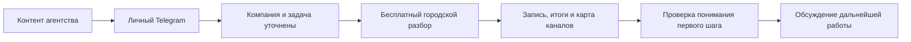

# Контент → городской разбор → комплексная работа

Работа → [CDC-J01](../../../../_index.md), сегмент → [CDC-S01](../../_index.md), знания о людях → [audience](../../audience/_index.md). Здесь одна связка; она не владеет всем исследованием ниши.

| Поле | Канонический материал |
|---|---|
| Основания аудитории и поставки | Выводы CDC-S01-I01–I04 в базе сегмента; конкретные наблюдения в [указателе](../../../../../../research/observations/_index.md) |
| Связь знания с материалом | [Карта применения](application-map.md) |
| Привлечение и адреса | [Acquisition](acquisition.md) |
| Первая польза, условия и методика карты | [Activation](activation.md) |
| Переход к покупке | [Revenue](revenue.md) |
| Сценарий завершения разбора и предложение | [R01-v1](sales-transition.md) |
| Продолжение и рекомендации | [Retention](retention.md), [Referral](referral.md); сегментная механика не проверена |
| Материалы исполнения | [Рабочий комплект](working-kit.md) |
| Один подготовленный первый выпуск | [C01](first-release.md) |
| События и показатели | [Измерение связки](measurement-and-test.md) |
| Фактические проверки | [Общий реестр](../../../../../../measurement/experiments.md) |

Критерий первой пользы — кандидат для проверки, а не доказанная связь с удержанием. Платный двухнедельный проект не обязателен перед месяцем. Новые конверсии, сроки продаж и результаты этой связки не установлены.

## Как наращивать

Новый факт о покупателе сначала проходит через наблюдение и базу аудитории. Здесь добавляется ссылка на применённый вывод и меняется соответствующий материал. Версия материала фиксируется в проверке; прежние и новые результаты не объединяются без описания различий. Коммерческие условия, роли и цены клиента не копируются из канонических владельцев.
