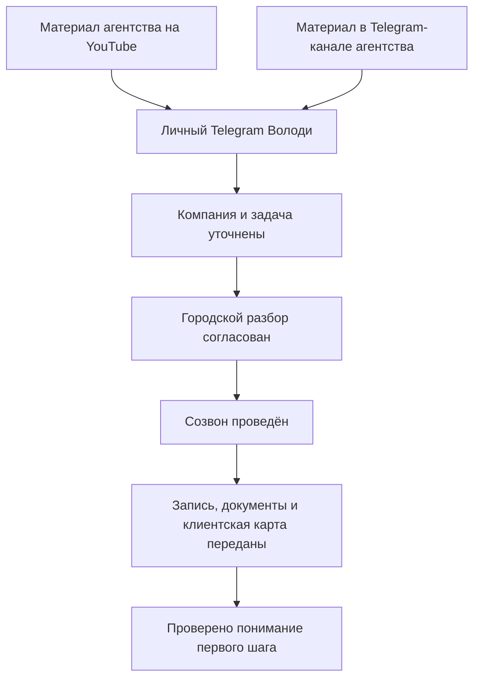

# Рабочий комплект первых двух этапов

Объект → [воронка CDC-F01](_index.md) внутри [одного JTBD](../../../../_index.md) и [одного сегмента](../../_index.md). Это входная страница практических материалов. Знания о покупателях принадлежат [базе аудитории](../../audience/_index.md); здесь связаны черновики, регламент и измерение конкретной воронки.

## Конструкция для проверки

Это проект связки, а не измеренная история покупки. Между контентными площадками нет обязательной подписки или перехода. Карта после разбора относится к маркетингу химчистки; источники самого агентства ей не назначаются автоматически.

## Подготовленные материалы

| Назначение | Что готово | Где |
|---|---|---|
| Логика тем | Девять редакционных направлений с основанием и вопросом собственника | [Редакционная карта](acquisition-editorial-map.md) |
| Первый выпуск | Сценарий объяснения городского разбора и приглашение | [C01](acquisition-content.md) |
| Другие выпуски | Три самостоятельных сценария: выход разбора, чтение карт, задача на развитие | [V02–V04](acquisition-video-scripts.md) |
| Контент канала | Один исходный пост и шесть дополнительных самостоятельных текстов | [Исходный пост](acquisition-content.md#пост-для-контентного-канала-агентства--проект), [P01–P06](acquisition-posts.md) |
| Короткий формат | Четыре сценарных фрагмента | [S01–S04](acquisition-posts.md#короткие-видео) |
| Обвязка видео | Описание и закреплённый комментарий | [Тексты перехода](acquisition-posts.md#переходы-под-видео) |
| Входящий контакт | Логика квалификации, ветки, договорённость о разборе, передача итогов | [Коммуникация](activation-comms.md) |
| Выполнение пользы | Регламент подготовки и проведения по известному составу | [Регламент](activation-runbook.md) |
| Выход | Пустой шаблон наблюдений, выводов и очередности каналов | [Шаблон результата](activation-result-template.md) |
| Измерение | События, поля, знаменатели, нагрузка и разбор остановок | [Проверка связки](measurement-and-test.md) |
| Фактическая сверка | Какие формулировки имеют основания и где ограничены | [Матрица доказательств](evidence-matrix.md) |
| Связь с аудиторией | Применение выводов и наблюдений в темах, разборе и предложении | [Карта применения](application-map.md) |
| Переход к предложению | Итог разбора, выбор способа исполнения, ветки и каркас письменного предложения | [R01-v1](sales-transition.md) |

Набор — библиотека для последовательного выбора, не календарь и не требование выпустить всё сразу. Тексты прошли редакторский и корректурный проход; они не получили из этого проверенную конверсию.

## Что можно подготовить без новых сведений

Снять текстовое объяснение по C01 без клиентских чисел; адаптировать подготовленные посты к выбранному каналу; использовать шаблон результата как демонстрацию формы; провести внутреннюю ролевую проверку сообщений и пройти регламент на доступном объекте с явно подписанными пробелами.

Эти возможности не означают, что съёмка, публикация, внутренний прогон или новый разбор уже выполнены. Текущая работа создала материалы и методику.

## Что требует факта перед использованием

| Поле | Почему важно | Текущее знание |
|---|---|---|
| Условия доступности разбора | Человек должен понимать, что ему предлагают | Подтверждены в [Activation](activation.md#условия-городского-разбора); перед встречей проверяется реальное окно |
| Исходник для демонстрации города | Нужен для показа конкретных данных | Для V03 найден внутренний исторический срез; публичное использование не согласовано |
| Время и координация | Нужны для реальной договорённости с человеком | Длительность созвона и недельная доступность подтверждены в Activation; часы ответа, конкретные окна и время подготовки не установлены |
| Переходы в клиентской карте | Нужны для обоснования конкретного следующего шага | [Очередность](activation.md#логика-очередности-каналов-клиента) и [критерии подготовки](activation.md#готовность-карт-и-сайта-перед-директом) описаны; технические подробности и исключения уточняются применительно к компании |

Личный Telegram для обращений и контентный канал подтверждены Володей 2026-11-11 → [адреса и назначение](acquisition.md#адреса-площадок). Адреса подставлены в контентные черновики; это поле больше не является пробелом подготовки. Отдельный канал MAX не указан.

## Роли и финансовая граница

Владельцы функций принадлежат [команде](../../../../../../../../../team/_agency.md#контур-химчисток-одежды). Регламент не возвращает account Софье и не назначает Директ Володе вместо обновлённого распределения. Разделение общения между Володей и Ольгой в каждом конкретном входящем обращении ещё нужно организовать.

Правило себестоимости и нагрузки Володи принадлежит [финмодели](../../../../../../../../finmodel.md#нагрузка-володи). Учёт разборов собирает и деньги, и часы; новые вменённые ставки не вводятся. Готовность комплекта не доказывает свободную мощность или возможность расширить общий портфель.

Цены и условия продуктов → [проект оффера](../../../../offer.md) и каноническая гипотеза по ссылкам из него. Первая польза и платный двухнедельный проект не смешиваются. Для перехода к предложению подготовлен R01-v1; его эффективность не проверена готовностью текста.

## Минимальная первая проверка — проект

Подготовлен [пакет одного первого выпуска](first-release.md): вариант заголовка, текст для обложки, выбранный сценарий, описание, закреплённый комментарий, пост в канал и путь обращения. Он не требует выпуска всей библиотеки одновременно; условия разбора подтверждены и внесены в приглашения.

**Конкретное предложение для первого цикла — C01 на собственном YouTube**, с описанием и закреплённым комментарием из подготовленной обвязки. Основание выбора площадки: собственный канал подтверждён в источниках, под него уже есть сценарий и он соответствует названному Володей предпочтению контентных источников. Это выбор кандидата для проверки, не утверждение об объёме целевой аудитории, одобренная дата публикации или доказательство лучшей эффективности YouTube.

Один выбранный материал, одна определённая площадка и один проверяемый путь обращения. Затем — реальные компания и задача, согласованный разбор, фактическая выдача результата и проверка понимания карты. У каждого события свой факт фиксации; прогнозы конверсии не подставляются.

В первом срезе важно понять, где рвётся связь: доступ к подходящей аудитории, обращение, согласование, встреча, передача или понимание результата. На этом основании выбирается изменение одного элемента, а не одновременно переписываются все материалы.

## Практическая граница текущего результата

Подготовлены материалы, шаблон и схема исполнения. Не проведены публикации, новые эфиры, рассылки, городской разбор по новой программе или тест на живом потоке. Доступы и оплаты не менялись, задачи YouGile не создавались. Реальные результаты и заполненные отчёты должны появиться из исполнения, а не из этой подготовки.
