# Новости и фото для карточек компаний

**Статус:** draft — пакеты подготовлены на трёх клиентах; публикация и влияние на обращения не измерены.  
**Тип:** производство контента / геомаркетинг  
**Владелец:** Володя  
**Проверено:** 2026-10-08

## Результат механики

Один месячный пакет на бренд: календарь тем, тексты новостей Яндекса, короткие сторис 2ГИС, фото, источники утверждений и набор допущенных точек. Отдельно фиксируем техническую готовность материала, допуск к размещению и подтверждённую видимость публикации. Одно не означает другое.

Факт: Яндекс прямо указывает, что публикации не влияют на позицию компании в поиске. Цель — объяснить предложение и помочь посетителю обратиться. Гипотеза об увеличении обращений требует измерения. Снимки позиций ведутся отдельно и не доказывают эффект новостей.

Термин «гейт» используем в значении [допуска](../core/glossary.md#term-gate). Проверки файлов после сборки — критерии готовности, а не доказательство результата.

## Порядок

```mermaid
flowchart LR
    A[Бриф и точки] --> B[Семантика и темы]
    B --> C[Источники и утверждения]
    C --> D[Текст и фото]
    D --> E[Проверка комплекта]
    E --> F[Допуск точки и площадки]
    F --> G[Пробная публикация]
    G --> H[Модерация и проверка видимости]
    H --> I[Остальные допущенные точки]
    I --> J[Замер и следующий месяц]
```



Отказ гейта останавливает только зависимый шаг: неподтверждённая цена удаляется из текста; неизвестная услуга исключает соответствующую точку; отсутствующий доступ останавливает размещение в этом кабинете. Подготовка других материалов продолжается.

## Гейты и критерии готовности

| Код | Перед каким шагом | Что должно сойтись | Подтверждение | Если не сошлось |
|---|---|---|---|---|
| G0 — объект | Сбор тем | Правильный бренд, регион, предложение и цель; текущая карточка клиента; факты отделены от гипотез; перечень адресов-кандидатов | Ссылки на клиентский паспорт и источник адресов, карточки ещё могут быть неизвестны | Не смешивать бренды; неизвестное оставить `?`; материалы готовить без неподтверждённого адресного оффера |
| G1 — спрос | Выбор темы | Запрос, оператор, регион, устройство, дата и источник замера; понятная ситуация покупателя | Выгрузка семантики; у XMLRiver quoted totalValue не обозначается как строгая [!WS] | Ошибка API означает неизвестность, не ноль. Нулевую тему можно оставить по доказанной услуге и ситуации с явным основанием. Аномальные числа не использовать для обещаний объёма спроса |
| G2 — факты | Черновик | Каждое проверяемое обещание связано с актуальным источником; услуга действительно предлагается; границы собственного/партнёрского производства названы | Реестр утверждений: источник, уровень подтверждения, дата, срок допустимости | Убрать или сузить утверждение; запросить только недостающий факт. Сайт и уверенный текст нейронки не доказывают текущую цену, срок или результат |
| G3 — редактура | Фото и адаптации | Одна ситуация, понятный заголовок, предложение и один следующий шаг; текст совпадает с услугой, нет переспама и придуманных новостей | Отдельный редакционный просмотр и запись его результата | Переписать конкретный фрагмент; не размножать шаблон с пустой заменой города |
| G4 — изображение | Сборка комплекта | Происхождение, основание использования, смысловое соответствие и пригодная композиция; реальный кейс отличён от иллюстрации | Фото + источник/промпт + визуальный просмотр обеих обрезок | Нельзя создавать «сотрудника», «наш цех», «выдачу клиенту» или «до/после» как доказательство. AI-предметный кадр — только иллюстрация. Реальный результат берём из реальной съёмки |
| G5 — файлы | Передача на размещение | Верный клиент и период; ID уникальны; все тексты и JPG на месте; размеры, читаемость, лимиты, ссылки и количество сходятся | `validate-geo-pack.py`, контрольная сумма фото, XLSX/ZIP и визуальный просмотр | Починить файлы; зелёный технический отчёт не подтверждает правдивость текста или работу кнопки |
| G6 — точка и формат | Размещение в конкретной карточке | ID/URL, адрес, принадлежность бренду и приём услуги сверены; кабинет доступен; нужный формат реально есть; контакт работает | Проверка каждой пары «точка × площадка» с датой и доказательством | Недопущенную пару пропустить. Если сторис 2ГИС недоступны, выбрать реально доступный формат и заново проверить адаптацию; не считать фотоальбом новостью |
| G7 — поручение | Первая внешняя запись | В сессии или рабочем поручении разрешены публикация, нужные карточки, период и содержание | Ссылка/описание уже данного поручения; оно действует в пределах согласованного объёма | Поручение на подготовку не даёт поручения на публикацию. Не запрашивать повторное разрешение, если оно уже есть. Новые цены, акции, кейсы и гарантии требуют новых подтверждений фактов, а не ритуального согласования каждого поста |
| G8 — пробный выпуск | Массовая раскладка | Один пост в одной допущенной карточке прошёл модерацию, виден пользователю, фото не обрезалось критически, кнопка ведёт куда обещано | URL/ID публикации, скриншот пользовательского вида, проверка кнопки | Исправить причину отказа/отображения. Не размножать неработающую адаптацию. Публикация может быть на модерации — это не live |
| G9 — масштаб | Следующие точки | По каждой точке G6 пройден; нет дубля; факты не истекли к её дате; подтверждены разрешённые посты | Пара «бренд × точка × площадка × post_id», версия и хеш, результат размещения | Не слать повторно при неизвестном ответе: сначала сверить кабинет. Не переносить один адрес и телефон на другую точку |
| G10 — результат | Оценка и новый месяц | Есть фактический выпуск и сопоставимые данные; звонки, клики и продажи различаются | Отчёт с периодом, источниками и ограничениями, доступная CRM-атрибуция | Нет данных — эффект `?`. Не объявлять публикации причиной роста без дизайна измерения; не повышать зрелость плейбука без измеренного результата |

## Бриф и контракт пакета

Один владелец каждого факта. Цена агентства, исполнитель, себестоимость и приоритет клиента остаются в [реестре](../../clients/_index.md). Здесь определяем роли, а не назначаем сотрудников конкретным клиентам.

Бриф содержит: бренд, целевую аудиторию, услуги и исключения, регион Wordstat, источники, адреса-кандидаты, разрешённые обещания, CTA, формат площадки и период. По умолчанию рекомендуем две темы в неделю, восемь на месяц; это допущение по нагрузке, не доказанная оптимальная частота.

Роли: куратор проверяет бриф и границы; редактор формулирует тему и проверяет текст; визуальный проверяющий смотрит оба кропа; публикующий сверяет кабинет и выпуск; аналитик связывает действия с доступными данными. Одного человека можно использовать в нескольких ролях. Не выдавать повторный проход той же моделью за независимую проверку.

Контракт готовности: восемь текстов Яндекса, восемь адаптаций для сторис, шестнадцать JPG, календарь, источники фактов, происхождение фото, комплектный manifest и отчёт валидатора. Допуск к размещению имеет отдельные условия G6–G9. Системный шаблон → [manifest](../templates/geo-news-pack-manifest.json).

## Источники и срок допустимости фактов

Рекомендованная редакционная политика, не правила площадок:

| Тип | Чем подтверждаем | Когда перепроверяем |
|---|---|---|
| Бренд, базовая услуга, постоянный процесс | Текущий бриф/паспорт, источник клиента или первоисточник | До месяца подготовки; срок в manifest до последней даты использования. Изменение состояния отзывает допуск сразу |
| Точка, телефон, приём услуги, доступный формат | Конкретная карточка и кабинет, актуальный ответ клиента | Перед первым выпуском, затем при изменении и минимум перед каждой новой недельной партией |
| Цена, акция, свободная мощность, точный срок | Датированный ответ владельца факта/прайс/система | До соответствующего выпуска; акция имеет начало/конец и условия. Не использовать старый прайс как текущую цену |
| Пошлины, утильсбор, правила ввоза | Актуальный официальный источник и расчёт специалиста по конкретному автомобилю | Перед публикацией такого материала; без них не писать ставки и готовые суммы |
| Кейс, отзыв, результат | Реальный заказ, подтверждённый результат, основание публичного использования | При сборке; изменения фото/текста/согласия требуют повторной проверки |
| Спрос | Замер с оператором и регионом | При подготовке месяца; предыдущий месяц спроса не выдавать за прогноз следующего |

`client_confirmed` означает сведения клиента; `public_source` — сведения публичного первоисточника. Ни один уровень сам по себе не означает независимый аудит. Гипотезы и рекомендации не переводятся в факты без источника. При недоступном сайте не выдумывать содержимое; использовать доступный подтверждённый бриф или явно оставить неизвестность.

## Адаптация площадок

Яндекс: публикации с текстом и фото, текст не более 3000 знаков с пробелами. Проверка может занять до семи дней; календарь содержит желаемые даты, а не обещанную дату появления. Начать подготовку следующего месяца за неделю до первой желаемой даты.

2ГИС: готовим сторис, проверяя наличие конструктора в реальном кабинете. Заголовок обложки до трёх строк; фото без вписанного текста; вертикальные кадры без пустых полей; текст и действие добавляются конструктором. Запрещённые направления ссылок сверяем с актуальными требованиями; ссылки на Яндекс Карты и список филиалов 2ГИС для кнопки не используем. Размеры 1200×900 и 1080×1920 — наш контракт артефактов, не утверждение об обязательных размерах площадки. Порог 180 знаков на слайд — редакционная рекомендация.

Предметное AI-фото может иллюстрировать деятельность при соответствии требованиям 2ГИС. Оно не доказывает наличие машины, выполненную услугу, интерьер или результат. Все реальные/AI-изображения проверяем на права, релевантность и достоверность подписи. Не требуется наклеивать водяной знак на каждую иллюстрацию; нельзя публиковать ложный документальный смысл.

## Работа с заводом

Берём из SEO-завода модуль данных и принцип «запрос → ситуация → бриф → текст → проверка». Очередь статей, конфиг и лимиты сайта Arcars не используются для выпуска материалов химчисток. Один экземпляр сайта не превращаем в общий клиентский планировщик.

Секреты остаются в `.env` завода и не попадают в отчёт, XLSX, ZIP, промпт, аргументы команды или журналы ошибок. Запросы выполняются через HTTPS. Утилита снимает данные, не меняет конфиг и не публикует статьи. Регион 225 — РФ, 51 — Самара, 65 — Новосибирск, 193 — Воронеж; текст «Самара» в запросе не заменяет фильтр региона.

```powershell
.tools/venv/Scripts/python.exe .tools/universal/seo/wordstat-snapshot.py --factory D:/SecondBrain/seo-factory --region 51 --region-name Samara --date 2026-10-08 --phrase "авто из китая" --out .tools/projects/arcars/geo-content/2026-10-08/frequency.json
.tools/venv/Scripts/python.exe .tools/universal/content/validate-geo-pack.py clients/arcars/reports/geo-content-2026-10-09--11-08/pack-manifest.json --as-of 2026-10-08 --out .tools/projects/arcars/geo-content/2026-10-08/gates.json
```

Для блокирующего технического допуска к размещению добавить `--require-publish-ready`. По умолчанию код возврата сообщает о корректности материалов; `publish_ready` всегда отдельно в JSON. Код не доказывает правдивость утверждений, не входит в кабинеты и ничего не отправляет. Происхождение ручного допуска подтверждается записью проверяющего с датой, сроком и доказательством; при изменении материала повторяем соответствующий просмотр.

## Выпуск, ошибки и версии

Ключ идемпотентности: клиент + точка + площадка + post_id. Перед отправкой сверить наличие публикации; при таймауте сначала прочитать состояние кабинета. Проверки и допуск точки привязываются к `bundle_sha256` текущих текстов, фактов, происхождения и хешей фото. Изменение текста/фото создаёт новую версию и повторяет G2–G5; изменение цены/контакта/адреса также отзывает зависимый допуск точки. Поручение задаёт клиента, ID постов, точки и площадки. Модерационный отказ разбирается по заявленной причине, не лечится многократной отправкой.

Следы выпуска — ID/URL, дата фактической видимости, версия, скриншот и причина отказа — храним рядом с инструментом вне git. Задачи, assignee, расписание исполнения, статусы модерации и очереди переделок — в YouGile. В волте остаются переиспользуемые правила, конечные клиентские пакеты и выводы; не создаём второй трекер публикаций.

## Измерение

Перед выпуском сохранить базовый сопоставимый период по карточкам: просмотры, действия с телефоном, переходы, маршруты; источник и способ счёта указать. Клик по телефону — не подтверждённый разговор; маршрут — не визит; форма — не продажа. Если сайт и сбор заявок проверены, использовать метки/атрибуцию; не ставить непроверенную форму в CTA.

Сравнить периоды одинаковой длины и сопоставимые дни недели, учесть сезонность, рекламу, изменение часов/услуг и разницу фактического времени выхода. При достаточном числе сходных точек можно вводить публикации по очереди и оставить сравнение; при малом объёме данных не делать причинный вывод. Порог успеха задавать после базового среза, не выдумывать проценты заранее. При недоступной CRM отчёт ограничивается доступными действиями и обращениями.

## Текущие применения и ограничения

- [UNISEC: месячный пакет](../../clients/unisec-novosibirsk/reports/geo-content-2026-10-09--11-08/content-plan.md): нет подтверждённой матрицы приёма по точкам и ID карточек.
- [Стиралкин: месячный пакет](../../clients/stiralkin/reports/geo-content-2026-10-09--11-08/content-plan.md): партнёрские ковры отделены; точки и доступный формат требуют сверки.
- [Arcars: месячный пакет](../../clients/arcars/reports/geo-content-2026-10-09--11-08/content-plan.md): расхождение адресов и непроверенный сбор заявки; CTA — подтверждённый телефон, без адресного приглашения.

Это материалы подготовки, а не доказательства маркетингового результата. Статус остаётся draft до записи применения с измеренным результатом по канону. Фото/семантику и пакет можно проверять сейчас; публикация требует собственных допусков.

## Источники

- [Яндекс: публикации, лимит и модерация](https://yandex.ru/support/business-priority/ru/manage/publications).
- [Яндекс: роли пользователей и доступ к сети](https://yandex.ru/support/business-priority/ru/manage/accesses).
- [2ГИС: сторис в карточках](https://dostavili.2gis.ru/public/0324/stories/).
- [2ГИС: требования к фото, AI-изображениям, сторис и кнопкам](https://law.2gis.ru/advert-rules/technical-requirements/).
- [Яндекс: идентификаторы регионов](https://yandex.ru/dev/webmaster/doc/ru/reference/feeds-regions).
- [XMLRiver: получение частотности и смысл history](https://xmlriver.com/apiwordstatnew/apiwn-about/).
