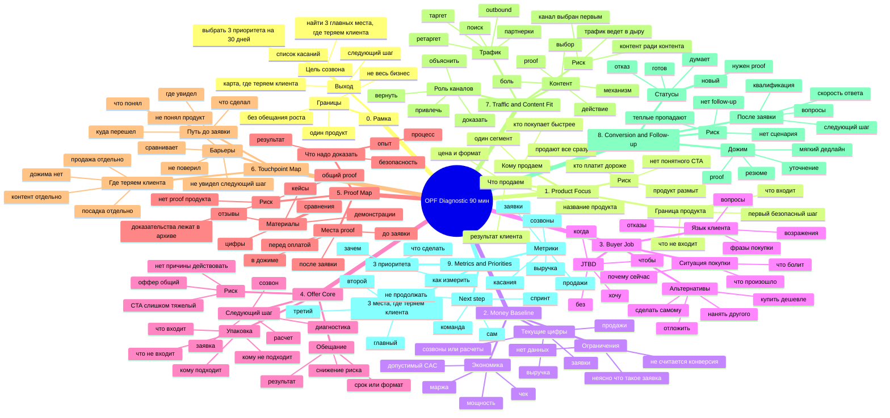

# One Product Flow — майнд-карта консультации

> Карта для ведения 90-минутного OPF Diagnostic. Цель консультации — не "дать маркетинговые советы", а найти, где у одного продукта рвётся путь до тёплой заявки и покупки.

## Главный принцип ведения

```text
Не обсуждать каналы, контент и рекламу раньше продукта, денег, клиента, оффера и proof.
```

Если клиент уводит в "нам бы трафик / посты / лендинг", возвращать:

> Сначала зафиксируем, что именно продаём, кому, за какие деньги и почему человек должен поверить.

## Mermaid mindmap



## Ведущий сценарий на 90 минут

### 0. Рамка — 5 минут

**Цель:** поставить границы и не дать консультации расползтись.

Сказать:

> Сегодня не разбираем весь маркетинг. Берём один продукт и смотрим, где у него рвётся путь от первого касания до заявки и покупки. На выходе — 3 главных места, где теряем клиента и 3 приоритета на 30 дней.

Зафиксировать:
- какой продукт разбираем;
- что клиент считает успехом встречи;
- какой следующий шаг возможен после диагностики.

### 1. Product Focus — 10 минут

**Цель:** выбрать и сузить продукт.

Вопросы:
- Что именно продаём?
- Как клиент это называет?
- Какой результат получает покупатель?
- Сколько стоит?
- Что входит и не входит?
- Какой первый шаг к покупке?

Слушать красные флаги:
- "у нас много направлений";
- "под каждого клиента индивидуально";
- "сначала надо рассказать про всё";
- "цены разные, сложно сказать".

Выход:

```text
Продукт: ...
Сегмент: ...
Результат: ...
Первый шаг: ...
```

### 2. Money Baseline — 10 минут

**Цель:** понять текущую точку отсчёта и не обещать лишнего.

Вопросы:
- Сколько заявок было за последние 30/90 дней?
- Что считается заявкой?
- Сколько из них дошло до созвона/расчёта?
- Сколько продаж?
- Какой средний чек?
- Откуда сейчас приходят клиенты?
- Где цифры точные, а где ощущения?

Если цифр нет, фиксировать как место, где теряем клиента:

> Сейчас невозможно понять, что масштабировать, потому что не видно путь от касания до денег.

Выход:
- baseline;
- неизвестные;
- метрики, которые нужно начать считать.

### 3. Buyer Job — 15 минут

**Цель:** понять, почему человек покупает и что мешает.

Вопросы:
- Что происходит в жизни/бизнесе клиента перед покупкой?
- Почему он начинает искать решение именно сейчас?
- С чем он сравнивает ваш продукт?
- Чего боится?
- Какие вопросы задаёт до покупки?
- Почему отказывается?
- Какие фразы клиентов повторяются?

Формула:

```text
Когда [ситуация],
клиент хочет [решение],
чтобы [результат],
без [страх/потеря].
```

Выход:
- главный JTBD;
- 3 страха;
- 3 критерия выбора;
- 5 фраз клиента.

### 4. Offer Core — 15 минут

**Цель:** проверить, понятно ли предложение и следующий шаг.

Вопросы:
- Как сейчас звучит оффер?
- Что человек должен сделать после первого касания?
- Это лёгкий шаг или тяжёлое решение?
- Почему ему стоит действовать сейчас?
- Что снижает риск?
- Что обещаем, а что не обещаем?

Проверка:

```text
Клиент за 10 секунд понимает:
что это,
для кого,
какой результат,
что делать дальше?
```

Выход:
- рабочая формулировка оффера;
- CTA;
- что нужно упростить.

### 5. Proof Map — 15 минут

**Цель:** понять, чем закрывать недоверие.

Вопросы:
- Какие доказательства есть именно по этому продукту?
- Какие страхи они закрывают?
- Где клиент их видит?
- Что отправляется после заявки?
- Какие кейсы/отзывы/цифры лежат в архиве, но не работают в продаже?

Разложить:

| Страх клиента | Proof |
|---|---|
| не поверит в результат | кейс / цифра |
| боится риска | процесс / гарантия |
| сравнивает по цене | объяснение выбора |
| думает "это теория" | демонстрация |

Выход:
- список proof-материалов;
- какие сделать первыми;
- куда встроить.

### 6. Touchpoint Map — 15 минут

**Цель:** увидеть путь клиента и где он теряется.

Рисовать прямо по ходу:

```text
увидел
→ понял
→ заинтересовался
→ поверил
→ сделал первый шаг
→ получил ответ
→ получил proof
→ купил / отвалился
```

Вопросы:
- Где человек впервые видит продукт?
- Куда переходит?
- Что видит перед заявкой?
- Что получает после заявки?
- Где чаще всего пропадает?
- Где менеджер/эксперт подключается руками?

Выход:
- карта касаний;
- 3 места, где путь рвётся.

### 7. Traffic and Content Fit — 10 минут

**Цель:** не "выбрать канал", а понять роль канала.

Вопросы:
- Какие каналы уже есть?
- Что они должны делать: привлекать, объяснять, доказывать, возвращать?
- Куда ведём людей?
- На каком этапе нужен контент?
- Какие 5 тем должны закрыть путь?

Разделить:

| Этап | Контент / канал |
|---|---|
| узнавание боли | пост / видео / реклама |
| понимание механизма | разбор |
| доверие | кейс |
| действие | CTA / mini-screen |
| дожим | proof / follow-up |

Выход:
- 1-2 канала на ближайший тест;
- 5-10 тем контента;
- куда вести трафик.

### 8. Conversion and Follow-up — 10 минут

**Цель:** проверить, что происходит после интереса.

Вопросы:
- Кто отвечает на заявку?
- Как быстро?
- Какие вопросы задаёт?
- Что отправляет?
- Как закрывает на следующий шаг?
- Что происходит с теми, кто не купил сразу?
- Есть ли статусы?

Минимальный follow-up:

```text
день 0 — резюме и следующий шаг
день 1 — proof
день 3 — уточнение
день 7 — мягкое предложение решения
день 14 — закрывающий follow-up
```

Выход:
- 3 вопроса для квалификации;
- 3 касания follow-up;
- статусная карта лидов.

### 9. Итог — 10 минут

**Цель:** собрать выводы и не превратить консультацию в "поговорили интересно".

Формат итога:

```text
Главное место, где теряем клиента:
1.

Второе место, где теряем клиента:
2.

Третье место, где теряем клиента:
3.

3 приоритета на 30 дней:
1.
2.
3.

Что не трогать сейчас:

Что измерить:

Следующий шаг:
```

Варианты next step:

| Вариант | Когда |
|---|---|
| Делаете сами | есть ресурс внедрить 3 приоритета |
| OPF Sprint | нужен ведущий и сборка вместе |
| Implementation | есть бюджет, команда, понятная экономика |
| Не продолжаем | нет продукта, данных или готовности |

## Короткая карта на один экран

```text
0. Рамка
   Один продукт. 3 места, где теряем клиента. 3 приоритета.

1. Продукт
   Что продаём? Кому? За сколько? Какой первый шаг?

2. Деньги
   Заявки → созвоны → продажи → выручка. Что знаем, чего не знаем?

3. Клиент
   Когда покупает? Зачем? Чего боится? С чем сравнивает?

4. Оффер
   Понятно ли за 10 секунд, что делать дальше?

5. Доверие
   Какие proof закрывают страхи до покупки?

6. Касания
   Где видит, куда идёт, где пропадает?

7. Трафик и контент
   Какой канал какую роль играет?

8. Заявка и дожим
   Кто отвечает, что отправляет, как возвращает?

9. Итог
   3 места, где теряем клиента → 3 приоритета → next step.
```

## Фразы-маркеры для ведения

Когда клиент уходит в каналы:

> Канал обсудим, но сначала надо понять, куда он ведёт и что человек там должен сделать.

Когда клиент говорит "нужно больше заявок":

> Возможно. Но сначала проверим, не теряются ли уже существующие тёплые люди между касанием, заявкой и покупкой.

Когда клиент расплывается по продуктам:

> Для этой диагностики выбираем один продукт. Иначе мы не соберём систему, а снова уйдём в общий маркетинг.

Когда нет цифр:

> Это не проблема, но это ограничение. Значит одним из первых действий будет начать считать путь от заявки до денег.

Когда хочет гарантию роста:

> Рост можно обсуждать после baseline. Сейчас задача — найти места, где теряем клиента и выбрать действия, которые можно проверить.

## Что заполнять во время консультации

| Блок | Запись |
|---|---|
| Продукт | |
| Сегмент | |
| Цена / чек | |
| Текущие заявки | |
| Текущие продажи | |
| Главный JTBD | |
| Главный страх | |
| Оффер сейчас | |
| CTA сейчас | |
| Proof есть | |
| Proof нужен | |
| Где путь рвётся 1 | |
| Где путь рвётся 2 | |
| Где путь рвётся 3 | |
| Приоритет 1 | |
| Приоритет 2 | |
| Приоритет 3 | |
| Следующий шаг | |
