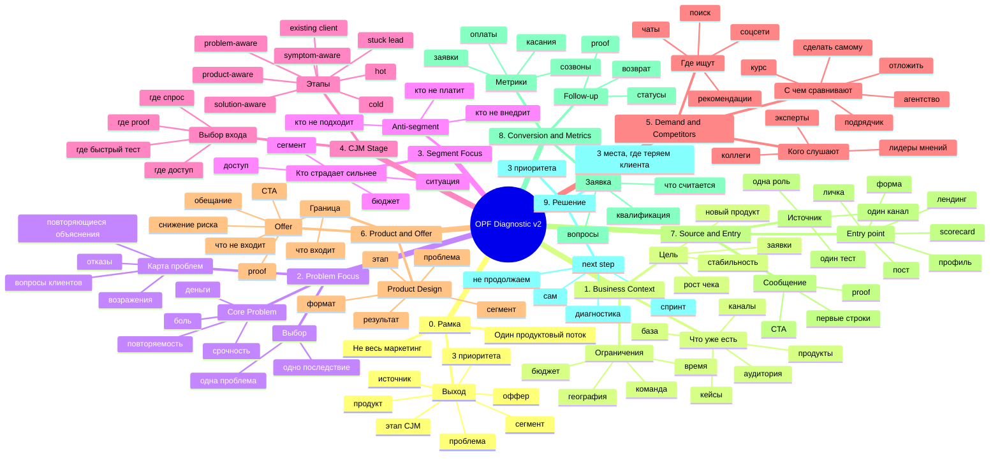

# One Product Flow — консультация v2 с CJM-входом

> **Outdated (архив логики), текущая версия → [method-canonical-v3](method-canonical-v3-2026-07-06.md) + [consultation-90min-v3](consultation-90min-v3-2026-07-06.md).** Карта идёт segment-first (2 Problem Focus → 3 Segment Focus «кто страдает сильнее») без слоя работ. Канон v3 — работа→сегмент. Храним как историю.

> Цель консультации: выбрать **одну проблему, один сегмент, один этап CJM и один вход в поток**, а не сразу строить "маркетинг всего".

## Mermaid mindmap



## Сценарий на 90 минут

### 0. Рамка — 5 минут

Сказать:

> Сегодня не строим весь маркетинг. Выбираем одну проблему, один сегмент и один этап клиентского пути, чтобы понять, какой продукт, оффер и источник тестировать первыми.

Выход:

```text
Фокус консультации:
...
```

### 1. Business Context — 5 минут

Вопросы:
- Что уже продаёте?
- Что хотите усилить?
- Какие каналы/аудитория/кейсы уже есть?
- Где сейчас главный затык: заявки, качество лидов, продажа, дожим, продукт?

Выход:
- активы;
- ограничения;
- цель.

### 2. Problem Focus — 10 минут

Вопросы:
- Какие проблемы клиенты чаще всего озвучивают?
- Что вы каждый раз объясняете вручную?
- На чём люди сомневаются?
- Почему отказываются?
- Где теряются деньги?

Выбрать одну проблему по критериям:
- боль;
- деньги;
- срочность;
- повторяемость;
- доступность.

Выход:

```text
Главная проблема:
...
```

### 3. Segment Focus — 10 минут

Вопросы:
- У кого эта проблема болит сильнее всего?
- Кто уже платит за решение?
- Кто быстрее принимает решение?
- К кому у вас есть доступ?
- Кто не подходит?

Выход:

```text
Сегмент:
...

Anti-segment:
...
```

### 4. CJM Stage Choice — 15 минут

Вопрос:

> В какой момент пути мы будем вклиниваться?

Этапы:

```text
cold
symptom-aware
problem-aware
solution-aware
product-aware
hot
stuck lead
existing client
```

Для каждого подходящего этапа спросить:
- что человек уже понимает?
- что он ещё не понимает?
- где он ищет?
- кого слушает?
- что ему нужно, чтобы сделать следующий шаг?
- есть ли у нас proof для этого этапа?

Выход:

```text
Выбранный этап CJM:
...

Почему:
...
```

### 5. Demand and Competitors — 15 минут

Вопросы:
- Где они ищут решение?
- Какие слова используют?
- Кого слушают?
- Какие альтернативы рассматривают?
- Кто уже продаёт похожее?
- Чем эти решения сильны?
- Где незанятое место?

Выход:

```text
Источники спроса:
1.
2.
3.

Альтернативы:
1.
2.
3.

Незанятое место:
...
```

### 6. Product and Offer — 15 минут

Собрать продукт по формуле:

```text
проблема + сегмент + этап готовности + результат + механизм + формат + proof + первый шаг
```

Вопросы:
- Какой формат лучше закрывает боль: разбор, консультация, спринт, сервис, группа, шаблон?
- Что человек получает?
- За какой срок?
- Что снижает риск?
- Какой первый безопасный шаг?

Выход:

```text
Продукт:
...

Оффер:
...

CTA:
...
```

### 7. Source and Entry — 10 минут

Вопросы:
- Какой один источник берём первым?
- Почему там есть нужный этап готовности?
- Куда ведём человека?
- Что он видит первым?
- Что должно убедить его оставить заявку?

Выход:

```text
Источник:
...

Точка входа:
...

Первое сообщение / экран:
...
```

### 8. Conversion, Follow-up, Metrics — 10 минут

Вопросы:
- Что считается заявкой?
- Какие 3 вопроса задаём?
- Что отправляем после интереса?
- Как возвращаем тех, кто завис?
- Какие метрики смотрим через 7/14/30 дней?

Выход:

```text
Заявка:
...

Follow-up:
...

Метрики:
...
```

### 9. Итог — 10 минут

Собрать:

```text
1 проблема:

1 сегмент:

1 этап CJM:

1 продукт:

1 оффер:

1 источник:

1 точка входа:

3 места, где теряем клиента:
1.
2.
3.

3 приоритета на 30 дней:
1.
2.
3.

Next step:
```

## Фразы для удержания рамки

Когда клиент хочет сразу канал:

> Канал выберем после этапа CJM. Сначала надо понять, в какой момент пути мы хотим поймать человека.

Когда клиент говорит "продукт уже есть":

> Ок, тогда не создаём с нуля, а проверяем: из какой проблемы и сегмента этот продукт вырос, и на каком этапе его правильно продавать.

Когда клиент уходит в широкую ЦА:

> Для теста нужен один сегмент. Иначе оффер будет говорить со всеми и не попадёт ни в кого.

Когда хочет лендинг:

> Посадка зависит от этапа готовности. Горячему нужен один экран, тёплому — диагностика, холодному — объяснение проблемы.

Когда спорит про продукт:

> Продукт — это не то, что нам удобно продавать. Это конкретное решение конкретной боли в конкретном сегменте.
