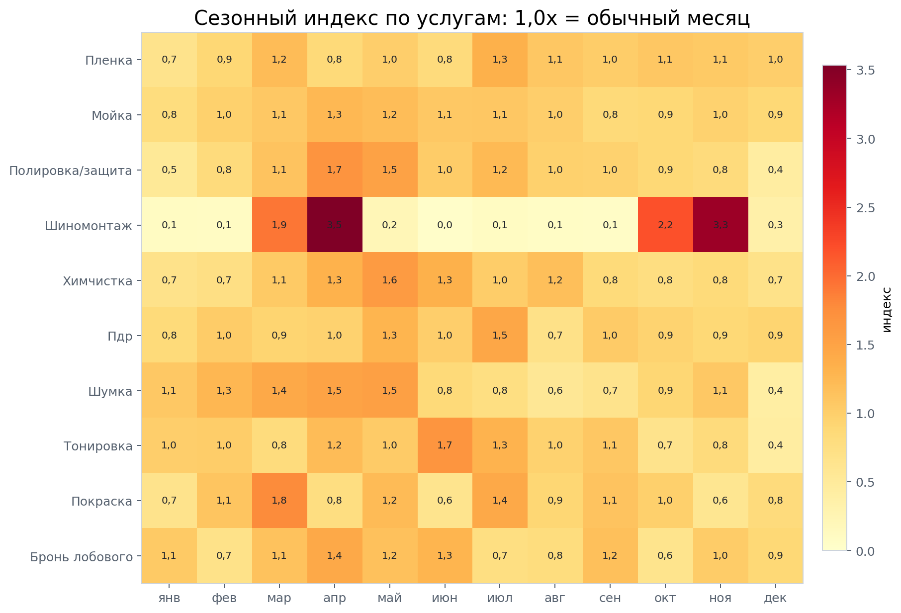
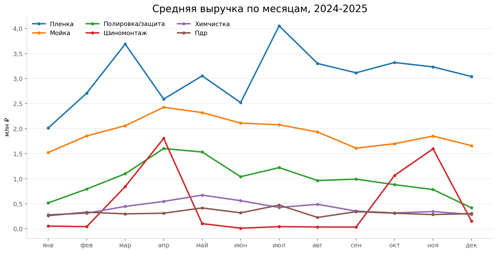
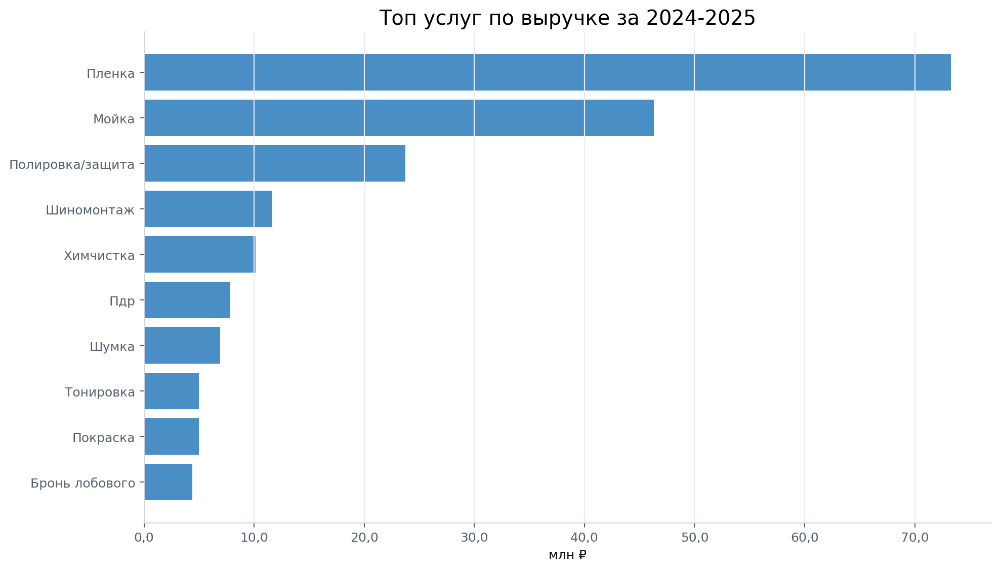

# Сезонность услуг Левши

Дата расчета: 2026-05-19.

Источник: та же 1С-выгрузка `Продажи по заказам`, что используется в базовом анализе. Анализ начинается с января 2024, потому что до этого был переход на 1С и исторические данные могли быть неполными.

Методика:
- сезонный профиль считается по полным годам 2024-2025;
- 2026 не входит в сезонный индекс, потому что данные есть только до 27.04.2026;
- единица денег — строки услуг в заказ-нарядах после исключения автосервиса/запчастей, служебных строк и технических клиентов;
- `Материал Пленка` учитывается внутри категории `Антигравийная пленка`, потому что это строка материала/себестоимости для расчета ЗП, а не отдельный розничный продукт.

## Контроль данных

- Период сезонности: 2024-2025, полные годы.
- Выручка строк услуг за 2024-2025 = помесячная выручка: 199 177 849 ₽.
- 2026 используется только как YTD-контекст: данные до 27.04.2026.

## Короткий вывод

Главный календарный вывод: плёнка — не только самая крупная категория, но и категория с выраженными пиками летом и отдельным весенним всплеском. Для маркетинга её нельзя вести ровным фоном: нужны заранее подготовленные усиления под месяцы спроса.

- **Антигравийная пленка:** пик — июл (1,3x среднего месяца), сильные месяцы: июл, мар, авг.
- **Мойка:** пик — апр (1,3x), сильные месяцы: апр, май, июл.
- **Шиномонтаж:** пик — апр (3,5x), сильные месяцы: апр, ноя, окт.
- **Полировка/защита:** пик — апр (1,7x), сильные месяцы: апр, май, июл.

## Топ услуг по сезонности и выручке

| Услуга | Выручка 2024-2025 | 2024 | 2025 | 2025/2024 | Пик | Индекс пика | Сильные месяцы | Провал | Индекс провала |
|---|---|---|---|---|---|---|---|---|---|
| Антигравийная пленка | 73 284 326 ₽ | 37 695 055 ₽ | 35 589 271 ₽ | -5,6% | июл | 1,3x | июл, мар, авг | янв | 0,7x |
| Мойка | 46 278 787 ₽ | 25 497 157 ₽ | 20 781 630 ₽ | -18,5% | апр | 1,3x | апр, май, июл | янв | 0,8x |
| Полировка + защитные составы | 23 727 308 ₽ | 14 061 008 ₽ | 9 666 300 ₽ | -31,3% | апр | 1,7x | апр, май, июл | дек | 0,4x |
| Шиномонтаж | 11 618 328 ₽ | 6 722 102 ₽ | 4 896 226 ₽ | -27,2% | апр | 3,5x | апр, ноя, окт | июн | 0,0x |
| Химчистка | 10 116 430 ₽ | 5 557 390 ₽ | 4 559 040 ₽ | -18,0% | май | 1,6x | май, июн, апр | янв | 0,7x |
| Пдр | 7 805 988 ₽ | 4 169 368 ₽ | 3 636 620 ₽ | -12,8% | июл | 1,5x | июл, май, сен | авг | 0,7x |
| Шумовиброизоляция | 6 899 610 ₽ | 4 497 690 ₽ | 2 401 920 ₽ | -46,6% | май | 1,5x | май, апр, мар | дек | 0,4x |
| Тонировка | 4 962 190 ₽ | 3 390 380 ₽ | 1 571 810 ₽ | -53,6% | июн | 1,7x | июн, июл, апр | дек | 0,4x |

## Маркетинговый календарь

`Сезонный фокус` показывает услуги, у которых месяц выше обычного для этой услуги. `Лидеры оборота` показывает, где в среднем больше денег в абсолюте.

| Месяц | Сезонный фокус | Лидеры оборота | Слабые сезонные услуги |
|---|---|---|---|
| янв | Шумка (1,1x); Бронь лобового (1,1x); Тонировка (1,0x); Пдр (0,8x) | Пленка (2 014 100 ₽); Мойка (1 524 065 ₽); Полировка/защита (519 130 ₽); Шумка (289 150 ₽) | Шиномонтаж (0,1x); Полировка/защита (0,5x); Покраска (0,7x); Пленка (0,7x) |
| фев | Шумка (1,3x); Покраска (1,1x); Пдр (1,0x); Тонировка (1,0x) | Пленка (2 709 265 ₽); Мойка (1 855 780 ₽); Полировка/защита (795 310 ₽); Шумка (333 500 ₽) | Шиномонтаж (0,1x); Бронь лобового (0,7x); Химчистка (0,7x); Полировка/защита (0,8x) |
| мар | Шиномонтаж (1,9x); Покраска (1,8x); Шумка (1,4x); Пленка (1,2x) | Пленка (3 688 520 ₽); Мойка (2 059 670 ₽); Полировка/защита (1 099 960 ₽); Шиномонтаж (843 649 ₽) | Тонировка (0,8x); Пдр (0,9x); Химчистка (1,1x); Мойка (1,1x) |
| апр | Шиномонтаж (3,5x); Полировка/защита (1,7x); Шумка (1,5x); Бронь лобового (1,4x) | Пленка (2 590 880 ₽); Мойка (2 427 645 ₽); Шиномонтаж (1 806 322 ₽); Полировка/защита (1 604 056 ₽) | Покраска (0,8x); Пленка (0,8x); Пдр (1,0x); Тонировка (1,2x) |
| май | Химчистка (1,6x); Шумка (1,5x); Полировка/защита (1,5x); Пдр (1,3x) | Пленка (3 054 285 ₽); Мойка (2 321 780 ₽); Полировка/защита (1 534 180 ₽); Химчистка (674 867 ₽) | Шиномонтаж (0,2x); Пленка (1,0x); Тонировка (1,0x); Бронь лобового (1,2x) |
| июн | Тонировка (1,7x); Химчистка (1,3x); Бронь лобового (1,3x); Мойка (1,1x) | Пленка (2 520 948 ₽); Мойка (2 111 765 ₽); Полировка/защита (1 041 606 ₽); Химчистка (563 182 ₽) | Шиномонтаж (0,0x); Покраска (0,6x); Пленка (0,8x); Шумка (0,8x) |
| июл | Пдр (1,5x); Покраска (1,4x); Пленка (1,3x); Тонировка (1,3x) | Пленка (4 052 755 ₽); Мойка (2 078 204 ₽); Полировка/защита (1 223 295 ₽); Пдр (475 550 ₽) | Шиномонтаж (0,1x); Бронь лобового (0,7x); Шумка (0,8x); Химчистка (1,0x) |
| авг | Химчистка (1,2x); Пленка (1,1x); Мойка (1,0x); Полировка/защита (1,0x) | Пленка (3 300 805 ₽); Мойка (1 934 195 ₽); Полировка/защита (965 002 ₽); Химчистка (491 230 ₽) | Шиномонтаж (0,1x); Шумка (0,6x); Пдр (0,7x); Бронь лобового (0,8x) |
| сен | Бронь лобового (1,2x); Покраска (1,1x); Тонировка (1,1x); Пдр (1,0x) | Пленка (3 115 530 ₽); Мойка (1 612 005 ₽); Полировка/защита (993 700 ₽); Химчистка (355 000 ₽) | Шиномонтаж (0,1x); Шумка (0,7x); Химчистка (0,8x); Мойка (0,8x) |
| окт | Шиномонтаж (2,2x); Пленка (1,1x); Покраска (1,0x); Пдр (0,9x) | Пленка (3 321 350 ₽); Мойка (1 700 275 ₽); Шиномонтаж (1 067 510 ₽); Полировка/защита (882 970 ₽) | Бронь лобового (0,6x); Тонировка (0,7x); Химчистка (0,8x); Мойка (0,9x) |
| ноя | Шиномонтаж (3,3x); Шумка (1,1x); Пленка (1,1x); Бронь лобового (1,0x) | Пленка (3 232 676 ₽); Мойка (1 852 605 ₽); Шиномонтаж (1 598 582 ₽); Полировка/защита (785 140 ₽) | Покраска (0,6x); Полировка/защита (0,8x); Тонировка (0,8x); Химчистка (0,8x) |
| дек | Пленка (1,0x); Пдр (0,9x); Бронь лобового (0,9x); Мойка (0,9x) | Пленка (3 041 050 ₽); Мойка (1 661 405 ₽); Полировка/защита (419 305 ₽); Пдр (305 825 ₽) | Шиномонтаж (0,3x); Шумка (0,4x); Тонировка (0,4x); Полировка/защита (0,4x) |

## Графики

## Как использовать

1. Для плёнки: готовить офферы и креативы заранее, до сезонного окна, а не в месяц пика. Пик в данных приходит уже как факт спроса.
2. Для шиномонтажа: использовать сезонные пики как якорь для записи на мойку/уход/плёнку, а не как отдельную низкомаржинальную услугу.
3. Для мойки: смотреть не только выручку, но и загрузку выходных. Мойка может быть входом в базу, но сама по себе не объясняет крупный чек.
4. Для полировки/защитных составов: использовать как докрутку к плёнке и как сезонный повод для возврата, а не как главный вход в постоянную базу.

## Файлы

- `service-seasonality-summary-2026-05-19.csv` — свод по услугам, пикам и провалам.
- `service-seasonality-monthly-2026-05-19.csv` — помесячная таблица по годам, услугам и сезонному индексу.
- `service-seasonality-calendar-2026-05-19.csv` — маркетинговый календарь по месяцам.
