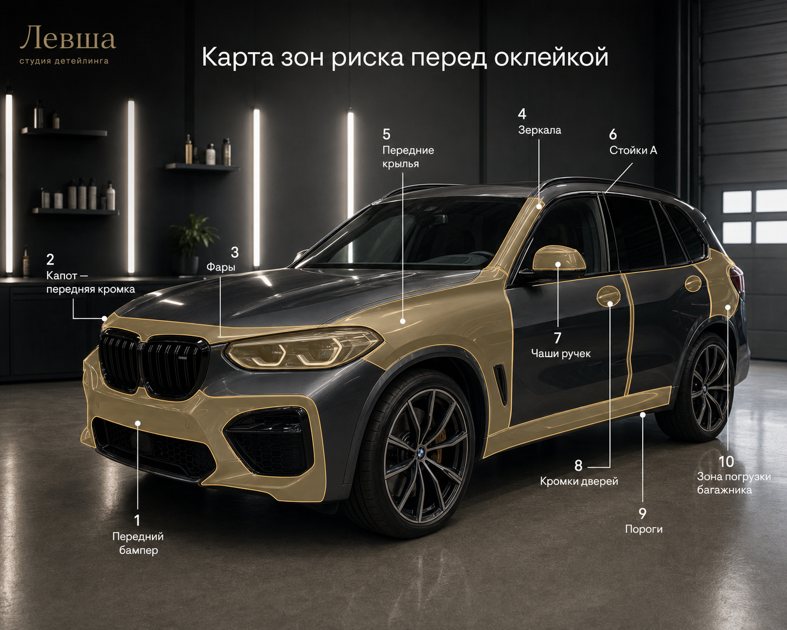

# VK-воронка на плёнку для Левши

## 1. Роль VK в воронке плёнки

VK не должен заменять горячий поиск. По данным базы Левши, **67% клиентов с плёнкой получают её сразу в первом визите**, значит основной канал покупки — прямой спрос: Я.Директ, Авито, карты, рекомендации.

Роль VK другая:

1. **Догревать людей, которые уже думают про защиту авто**, но ещё не готовы искать “оклейка плёнкой Самара”.
2. **Возвращать собственную базу**: мойка, тонировка, полировка, спящие 4-12 месяцев.
3. **Создавать дешёвый первый шаг**: расчёт 3 вариантов защиты по фото / бесплатная диагностика.
4. **Собирать аудитории ретаргета** на кейсах, видео и лид-формах.

Главный KPI VK на первом этапе — не продажа full body в лоб, а **лид на расчёт / диагностику**.

---

## 2. Главный оффер

Не продаём “оклейку плёнкой”. Продаём выбор без переплаты.

> **Получите 3 варианта защиты кузова по фото авто: минимальный, оптимальный и полный. Покажем, где можно не переплачивать.**

CTA:

1. `Получить расчёт по фото`
2. `Записаться на бесплатную диагностику`
3. `Узнать, какие зоны защищать в первую очередь`

Что обещаем:

- 3 варианта защиты: Light / Optimal / Max;
- предварительная вилка цены;
- объяснение, какие зоны реально страдают на конкретной машине;
- без обязательства записываться;
- если хватит фар/капота — так и скажем.

---

## 3. Продуктовая лестница

| Этап | Продукт | Роль |
|---|---|---|
| Attraction | Расчёт 3 вариантов по фото | низкий барьер входа |
| Activation | Бесплатная диагностика 40 минут | экспертность и доверие |
| Revenue | Light / Optimal / Max / Color | основной чек |
| Downsell | Фары / зоны риска / капот / ручки | сохранить продажу, если full/front дорогой |
| Upsell | бронь лобового, керамика, тонировка, мойка-уход | рост чека |
| Continuity | контроль через 2-4 недели, мойки по регламенту, осмотр каждые 6 мес | sticky-повтор |

---

## 4. Сегменты аудиторий

### A. Своя база

| Сегмент | Почему важен | Сообщение |
|---|---|---|
| Клиенты с плёнкой | похожая аудитория + повторная оклейка/контроль | “Проверьте состояние плёнки / защитите новые зоны” |
| Мойка 4-12 мес назад | самый большой объём дозревания; мойка часто перед плёнкой | “Помоем и покажем зоны риска кузова” |
| Тонировка | самая высокая конверсия во вторичный вход среди рабочих выборок: 13.1% | “Защитили стёкла — пора защитить кузов” |
| Полировка/керамика | уже заботятся о внешнем виде | “Сохраните эффект полировки защитой зон риска” |
| Спящие 6-12 мес | повод вернуться | “Давно не были — приезжайте на осмотр после сезона” |

### B. Look-alike / похожие

Приоритет seed-аудиторий:

1. Клиенты, у которых была антигравийная плёнка.
2. Клиенты с чеком по плёнке выше медианы.
3. Клиенты с плёнкой + повторными визитами.
4. Клиенты тонировки.
5. Клиенты мойки, которые потом купили плёнку.

Не строить похожую аудиторию от всех клиентов Левши без сегментации: туда попадёт слишком много мойки, шиномонтажа, PDR и случайных транзакционных клиентов.

### C. Холодные аудитории

Холодные сегменты нужны как тест, но не как основной бюджет:

- владельцы авто / автоинтересы;
- премиальные марки и новые авто, если доступно в кабинете;
- Самара + радиус вокруг студии;
- аудитории, взаимодействовавшие с VK-сообществом Левши;
- зрители видео-кейсов 25% / 50% / 75%.

---

## 5. Структура кампаний

### Кампания 1. Своя база / PPF-ready

**Цель:** лид на расчёт или диагностику.  
**Аудитории:** тонировка, мойка 4-12 мес, полировка/керамика, спящие 6-12 мес.  
**Оффер:** “3 варианта защиты по фото / бесплатный осмотр зон риска”.

Креативы:
- карта зон риска;
- фото “сколы на капоте/фарах”;
- кейс до/после;
- “full body не всегда нужен”.

### Кампания 2. Look-alike по плёночным клиентам

**Цель:** лид на расчёт.  
**Аудитория:** похожие на плёночных клиентов / плёночных с высоким чеком.  
**Оффер:** “Подберите защиту под вашу машину без переплаты”.

Креативы:
- дорогая машина в процессе оклейки;
- мастер показывает зоны риска;
- сравнение Light / Optimal / Max;
- гарантия и бренд антигравийной плёнки Quantum: Pro 7 лет / Rocket 5 лет.

### Кампания 3. Холодный прогрев через видео/кейсы

**Цель:** собрать вовлечённую аудиторию и дешёвый ретаргет.  
**Аудитория:** автоинтересы, Самара, премиум-авто, похожие широкие.  
**Оффер:** не сразу заявка, а сильный короткий кейс.

Креативы:
- “Что происходит с капотом за 4 года без плёнки”;
- “Front или full body: где реально переплачивают”;
- “Почему фары и бампер ловят удар первыми”;
- видео процесса с подворотами и краями.

### Кампания 4. Ретаргет

**Цель:** довести до заявки тех, кто уже проявил интерес.  
**Аудитории:**
- смотрели видео 50%+;
- открывали лид-форму, но не отправили;
- переходили на лендинг;
- взаимодействовали с постами/сообществом;
- были в базе, но не записались.

Сообщение:

> “Вы смотрели защиту кузова. Можем бесплатно посчитать 3 варианта для вашей машины: минимальный, оптимальный и полный.”

---

## 6. Варианты креативов

### Пример визуала: карта зон риска

Формат: 5:4.  
Задача визуала: быстро показать клиенту, какие зоны кузова первыми страдают без плёнки, и подвести к расчёту 3 вариантов защиты.

Схематичный пример для дизайнера:

### Угол 1. Новая машина

**Заголовок:** Защитите кузов до первого скола  
**Текст:** Новая машина быстро ловит пескоструй на капоте, фарах и бампере. Рассчитаем 3 варианта защиты: минимальный, оптимальный и полный.  
**CTA:** Получить расчёт

### Угол 2. Без переплаты

**Заголовок:** Full body нужен не всем  
**Текст:** Покажем, какие зоны реально страдают на вашей машине, и подберём защиту без лишних зон. Если хватит фар и капота — так и скажем.  
**CTA:** Подобрать защиту

### Угол 3. Трасса / сколы

**Заголовок:** Камни первыми бьют переднюю часть  
**Текст:** Если часто ездите по трассе, зоны риска понятны: капот, бампер, фары, зеркала. Рассчитаем защиту под ваш маршрут и машину.  
**CTA:** Рассчитать по фото

### Угол 4. Продажа через 3-4 года

**Заголовок:** Сохраните заводское ЛКП  
**Текст:** Плёнка помогает сохранить внешний вид и аргумент при продаже. Подберём пакет защиты под срок владения и бюджет.  
**CTA:** Получить 3 варианта

### Угол 5. Уже клиент Левши

**Заголовок:** Давно не проверяли кузов?  
**Текст:** Вы уже были в Левше. Приезжайте на осмотр зон риска: покажем, где кузов уже страдает и что можно защитить до серьёзных сколов.  
**CTA:** Записаться на осмотр

### Угол 6. Тонировка -> кузов

**Заголовок:** Стёкла защитили. А кузов?  
**Текст:** После тонировки следующий логичный шаг — защитить фары, капот и бампер. Рассчитаем варианты без обязательств.  
**CTA:** Рассчитать защиту

### Угол 7. Мойка -> диагностика

**Заголовок:** На мойке видно больше, чем кажется  
**Текст:** После правильной мойки хорошо видны сколы, битум, пескоструй и слабые зоны. Запишитесь на премиальную мойку с осмотром кузова.  
**CTA:** Записаться

### Угол 8. Премиум-доверие

**Заголовок:** Оклейка без видимых краёв  
**Текст:** Подвороты, аккуратные края, правильная подготовка кузова и гарантия. Покажем кейсы и подберём пакет под вашу машину.  
**CTA:** Посмотреть варианты

### Угол 9. Ошибка экономии

**Заголовок:** Дешевле закрыть зоны риска, чем красить  
**Текст:** Один скол можно пережить. Десятки сколов на капоте и фарах — уже торг при продаже. Посчитаем защиту заранее.  
**CTA:** Получить расчёт

### Угол 10. Диагностика как продукт

**Заголовок:** 40 минут — и вы понимаете, что защищать  
**Текст:** Осмотрим кузов, покажем зоны риска, дадим 3 сметы на руки. Бесплатно и без обязательства записи.  
**CTA:** Записаться на диагностику

---

## 7. Лид-форма VK

### Заголовок формы

Получить 3 варианта защиты кузова

### Описание

Оставьте контакты — специалист Левши уточнит модель авто и рассчитает варианты защиты: минимальный, оптимальный и полный.

### Поля

Обязательные:
- имя;
- телефон;
- марка и модель авто;
- год авто.

Дополнительные:
- машина новая / с пробегом;
- чаще город / трасса / смешанный режим;
- что интересует: фары / зоны риска / передняя часть / весь кузов / не знаю;
- удобно ли прислать фото авто.

### Экран после отправки

> Спасибо. Чтобы расчёт был точнее, подготовьте 3 фото авто: спереди, сбоку и крупно капот/фары. Специалист Левши свяжется с вами и предложит 3 варианта защиты.

---

## 8. Обработка лида

### SLA

- первый звонок: до 15 минут в рабочее время;
- если не дозвонились: сообщение + повтор через 2 часа;
- если клиент прислал фото: предварительная вилка в тот же день;
- задача в Битрикс24 создаётся сразу.

### Статусы в Битрикс24

1. Новый лид VK PPF
2. Не дозвонились
3. Уточняем авто / ждём фото
4. Расчёт отправлен
5. Записан на диагностику
6. Диагностика проведена
7. Смета выдана
8. Оплата / в работе
9. Отказ
10. Отложенный прогрев

### Мини-скрипт первого звонка

> [Имя], добрый день. Это Левша, вы оставляли заявку на расчёт защиты кузова. Чтобы не предлагать лишнее, уточню 3 вещи: какая машина, как чаще ездите — город или трасса, и что больше беспокоит: сколы, фары, внешний вид или продажа в будущем?

После ответа:

> Мы можем предварительно посчитать 3 варианта: минимальный, оптимальный и полный. По фото дадим вилку, а точно — после бесплатной диагностики в студии. Можете прислать 3 фото авто?

---

## 9. Ретаргет-сообщения

### Для смотревших видео/кейсы

> Видели наши кейсы по плёнке? Можем рассчитать защиту конкретно под вашу машину: где достаточно фар, где нужен front, а где выгоднее full body.

### Для открывших форму, но не отправивших

> Не обязательно сразу записываться на оклейку. Начните с расчёта 3 вариантов — это бесплатно.

### Для своей базы мойки

> Вы уже были в Левше. После мойки лучше всего видно, где кузов ловит сколы и пескоструй. Приезжайте на осмотр зон риска.

### Для тонировки

> Стёкла уже защищены. Следующий удар принимают фары, капот и бампер. Рассчитаем защиту кузова без обязательств.

---

## 10. Бюджет теста на 14 дней

Минимальный тест: **20 000-30 000 ₽**.

| Кампания | Доля | Бюджет при 30к | Зачем |
|---|---:|---:|---|
| Своя база / PPF-ready | 35% | 10 500 ₽ | самый тёплый сегмент |
| Look-alike по плёночным | 30% | 9 000 ₽ | поиск похожих |
| Холодный прогрев видео/кейсы | 20% | 6 000 ₽ | собрать аудиторию ретаргета |
| Ретаргет | 15% | 4 500 ₽ | дожим интересовавшихся |

Если бюджет меньше 20к, убрать холодный прогрев и оставить:
- своя база;
- look-alike;
- ретаргет.

---

## 11. Метрики

### Рекламные

| Метрика | Цель теста |
|---|---:|
| CTR | не ниже 1.0-1.5% для холодных, выше для базы |
| CPL лид-формы | до 1 500 ₽ |
| Доля валидных лидов | 60%+ |
| Стоимость валидного лида | до 2 500 ₽ |
| Конверсия лид -> расчёт | 50%+ |
| Конверсия расчёт -> диагностика | 20%+ |
| Конверсия диагностика -> продажа | 25%+ |

### Бизнесовые

| Метрика | Зачем |
|---|---|
| лиды по маркам авто | понять, кого привлекаем |
| средний потенциальный чек | не гнаться за дешёвыми лидами |
| пакет в смете: Light / Optimal / Max | видеть качество лидов |
| причина отказа | докрутить оффер |
| выручка по VK-лидам | финальный показатель |

---

## 12. Что подготовить до запуска

Минимум:

- 5-7 фото/видео кейсов плёнки;
- 1 простая карта зон риска;
- список брендов плёнки и гарантийные формулировки;
- таблица пакетов Light / Optimal / Max с вилками цен;
- лид-форма VK;
- UTM-метки;
- отдельный тег в Битрикс24: `vk_ppf_2026_05`;
- SLA обработки лида;
- шаблон расчёта 3 вариантов.

Желательно:

- короткое видео мастера на 20-30 секунд;
- кейсы по популярным моделям: BMW X5, Toyota Camry, Mercedes, Geely/Exeed, Lexus;
- FAQ “full или front”;
- фото подворотов/краёв/сложных зон.

---

## 13. Решение после теста

Через 14 дней смотрим не только CPL.

| Сценарий | Решение |
|---|---|
| CPL нормальный, но лиды мусорные | усложнить форму, добавить квалифицирующие вопросы |
| Лиды нормальные, но нет диагностики | проблема в обработке / скорости / скрипте |
| Диагностики есть, продаж нет | проблема в оффере, смете, цене, доверии |
| Есть продажи Optimal/Max | масштабируем look-alike и ретаргет |
| Идут только дешёвые запросы на фары | оставляем как downsell, но меняем креативы на более премиальные |

---

## 14. Главная гипотеза VK

Если в VK не продавать “оклейку плёнкой”, а предлагать **персональный расчёт 3 вариантов защиты без переплаты**, то мы получим более качественные лиды, потому что клиенту не нужно сразу выбирать full body/front body и бояться, что ему впарят лишнее.

Проверяем не лайки и не охваты, а цепочку:

`лид -> фото/данные авто -> расчёт -> диагностика -> смета -> оплата`.
