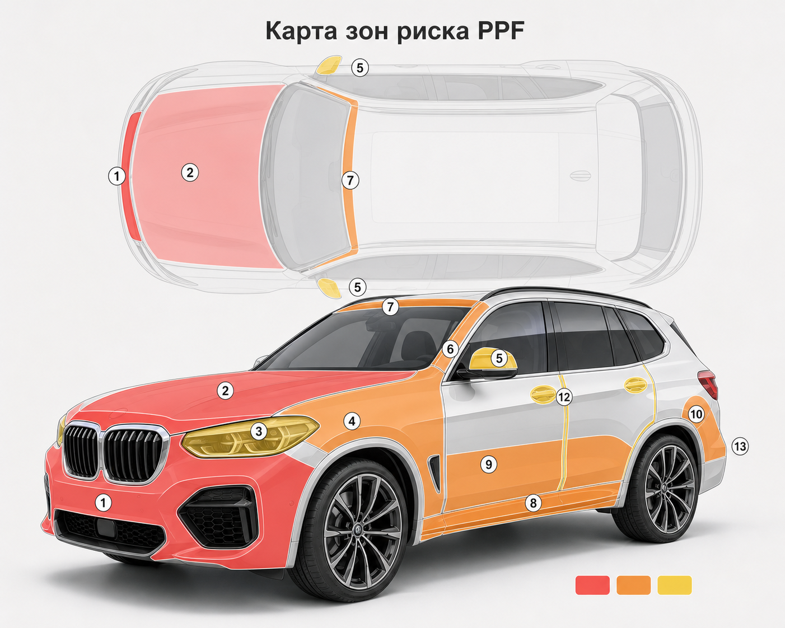

# VK-квиз-бот на плёнку (Левша)

## 0. Что это и зачем отдельно от лендинга

Лендинг закрывает горячий трафик из Я.Директа и поисков. ВК-аудитория — теплее по интересу, но холоднее по намерению. Сажать её на Tilda-квиз = терять конверсию: лишний переход, медленная загрузка, незнакомый интерфейс.

**Решение:** перенести логику квиза *внутрь* ВК — диалог с ботом сообщества. Клиент кликает по объявлению → сразу попадает в диалог Левши → проходит те же 7-9 шагов в формате «вопрос с кнопками».

**Главная гипотеза:** бот-квиз внутри ВК даёт +30-50% к конверсии «клик → лид» против переброса на лендинг. Проверяем за 14 дней теста по [vk-funnel.md](vk-funnel.md), бюджет 20-30к.

**Платформа:** Senler (есть в стеке Левши по reference) или SaleBot. Конкретный выбор — за подрядчиком, ТЗ платформо-нейтральное.

---

## 1. Карта воронки

```text
Креатив ВК (10 углов из vk-funnel.md §6)
        ↓
   Клик «Подобрать защиту» / «Узнать варианты»
        ↓
   Открывается диалог с сообществом @levsha
        ↓
   Бот: приветствие + согласие на квиз
        ↓
   Квиз 7 шагов (марка → год → состояние → сценарий → задача → объём → телефон → канал → фото)
        ↓
   Финал: запрос фото + подтверждение
        ↓
   Лид → Битрикс24 (тег vk_ppf_quiz_2026_05) + уведомление менеджеру в Telegram
        ↓
   SLA 15 минут: менеджер пишет первым в выбранном канале
        ↓
   Параллельно: нурчер 5 сообщений (день 1, 2, 4, 7, 14) для тех, кто не дошёл до фото / не ответил менеджеру
```

---

## 2. Точка входа: что говорит креатив, что говорит бот

Кнопка в объявлении ВК: **«Подобрать защиту»** или **«Получить 3 варианта»** (зависит от угла креатива — см. §7).

При клике клиент попадает в диалог с сообществом. **Первое сообщение бота должно соответствовать обещанию из объявления** — иначе ощущение «обманули, открыл и спам».

Соответствие угол → первое сообщение бота описано в §4.

---

## 3. Сценарий квиза (тексты + кнопки)

### Шаг 0. Приветствие (универсальное)

> Привет! Это Левша 🛡
>
> Сейчас за 1 минуту подберём, какие зоны кузова реально стоит защитить именно на вашей машине — без лишней оклейки и переплаты.
>
> В конце пришлём 3 варианта: минимальный, оптимальный и полный. Если хватит фар и капота — так и скажем.

Кнопки:
- `Поехали` → шаг 1
- `Сначала покажите кейсы` → блок «Кейсы» (см. §6), потом возвращаем на шаг 1
- `У меня уже есть вопрос — отвечу мастеру` → передача менеджеру (живой чат)

---

### Шаг 1. Марка и модель

> Окей. Какая у вас машина?
>
> Напишите марку и модель, например: *BMW X5* или *Toyota Camry*.

Без кнопок — текстовый ввод. Сохраняем в переменную `{auto}`.

Подсказка после ответа:
> Принял, {auto}. Дальше пара коротких вопросов.

---

### Шаг 2. Год выпуска

> Какой год?

Кнопки (3-4 диапазона + «другой»):
- `2024-2026 (новая)` → ставим флаг `new_car=true`
- `2020-2023` → `new_car=false`
- `2015-2019` → `new_car=false`
- `Старше 2015` → `new_car=false`

---

### Шаг 3. Состояние ЛКП

> Кузов сейчас в каком состоянии?

Кнопки:
- `Новая, идеальная` → `lkp=perfect`
- `Есть мелкие сколы и царапины` → `lkp=minor`
- `Заметные сколы / подкрасы` → `lkp=major`
- `Готовлю к продаже, надо привести в вид` → `lkp=sale`

---

### Шаг 4. Сценарий езды

> Как чаще ездите?

Кнопки:
- `Город` → `route=city`
- `Трасса / межгород` → `route=highway`
- `Смешанно` → `route=mixed`

---

### Шаг 5. Что важнее (главная задача)

> Что сейчас больше всего беспокоит или хочется решить?

Кнопки:
- `Сколы и пескоструй` → `goal=chips`
- `Фары мутнеют, ловят камни` → `goal=lights`
- `Сохранить внешний вид» → `goal=look`
- `Не потерять в цене при продаже` → `goal=resale`
- `Пока просто разбираюсь` → `goal=research`

---

### Шаг 6. Желаемый объём защиты

> Что рассматриваете в первую очередь?

Кнопки:
- `Фары + капот частично` → `scope=light`
- `Передняя часть целиком` → `scope=front`
- `Весь кузов` → `scope=full`
- `Помогите выбрать` → `scope=help`

После ответа — короткий комментарий по сегменту (необязательно, но повышает доверие):

| Ответ | Реакция бота |
|---|---|
| `light` | «Понятно. Это рабочий минимум для города — закрывает 70% сколов на капоте и фарах.» |
| `front` | «Самый ходовой пакет: 80% ударов прилетает в переднюю часть.» |
| `full` | «Хорошо. Для full body важно посмотреть кузов вживую — посчитаем точно на диагностике.» |
| `help` | «Окей, подберём вместе. После фото скажем, где можно не переплачивать.» |

---

### Шаг 7. Контакт

> Чтобы прислать расчёт и при необходимости запросить фото — оставьте телефон.

Текстовый ввод с валидацией формата.

Подсказка:
> Спамить не будем. Один контакт от менеджера — и расчёт в выбранном канале.

---

### Шаг 8. Канал связи

> Куда удобнее писать?

Кнопки:
- `Сюда, в ВК` → `channel=vk`
- `Telegram` → `channel=tg` → запросить @username или ссылку
- `MAX` → `channel=max` → запросить контакт
- `Позвонить` → `channel=call`

⚠️ WhatsApp и Авито-чат не предлагаем (см. [reference: messengers_ru]).

---

### Шаг 9. Фото авто (опционально, но важно)

> Последний шаг. Пришлите 2-3 фото машины — общий вид сбоку + перед крупно (капот, бампер, фары).
>
> Чем точнее фото — тем точнее расчёт без визита в студию.

Кнопки:
- `📷 Сейчас пришлю` → ждём загрузку, после фото → финал
- `Пришлю позже` → `photos=later`, помечаем лид, менеджер запросит сам → финал
- `Не хочу присылать` → `photos=no`, переводим на бронь диагностики → ветка «Диагностика»

---

### Финал А — фото пришли / обещаны позже

> Готово 🙌
>
> Передал расчёт мастеру. В течение **15 минут** в рабочее время (9:00-21:00) с вами свяжется специалист Левши в выбранном канале и пришлёт 3 варианта.
>
> Если заявка пришла ночью — ответим до 10:00 утра.
>
> А пока — посмотрите, как мы клеим: [ссылка на короткое видео-кейс].

Кнопки:
- `Посмотреть кейсы` → блок §6
- `Адрес студии` → отправляет геолокацию + фото бокса
- `Окей, жду` → закрытие диалога

---

### Финал Б — клиент выбрал «не хочу присылать фото»

> Без проблем. Тогда самый точный вариант — приехать на бесплатную диагностику: 40 минут, осмотрим кузов, дадим 3 сметы на руки. Решение принимаете дома, никто не записывает на месте.
>
> Когда удобнее?

Кнопки:
- `На этой неделе` → запросить день
- `На выходных` → запросить день
- `На следующей неделе` → запросить день
- `Пока подумаю` → закрыть, поставить в нурчер

---

## 4. Соответствие угол креатива → приветствие бота

Чтобы первое сообщение не выглядело универсальным шаблоном после клика по специфичному объявлению, под каждый из 10 углов из [vk-funnel.md §6](vk-funnel.md) — своя стартовая реплика. Дальше — общий сценарий с шага 1.

| # | Угол | Приветствие бота |
|---|---|---|
| 1 | Новая машина | «Поздравляем с новой машиной 🚗 Защитим её до первого скола. Пара коротких вопросов — и пришлём 3 варианта защиты.» |
| 2 | Без переплаты | «Full body нужен не всем. Сейчас за минуту разберёмся, какие зоны на вашей машине реально стоит защитить, а где можно не переплачивать.» |
| 3 | Трасса / сколы | «Если часто ездите по трассе — фары, капот и бампер ловят удар первыми. Подберём защиту под ваш маршрут.» |
| 4 | Продажа через 3-4 года | «Сохраним заводское ЛКП — при продаже это аргумент и плюс в цене. Подскажите пару деталей, посчитаем варианты.» |
| 5 | Уже клиент Левши | «Здравствуйте! Вы уже были у нас. Давайте проверим, что с кузовом сейчас, и подберём защиту зон риска.» |
| 6 | Тонировка → кузов | «Стёкла защищены — следующий логичный шаг защитить переднюю часть. Подберём пакет без обязательств.» |
| 7 | Мойка → диагностика | «После премиальной мойки лучше всего видно слабые места кузова. Запишемся на осмотр или сначала рассчитаем варианты по фото — как удобнее?» |
| 8 | Премиум-доверие | «Клеим без видимых краёв, с подворотами и подготовкой. Покажем кейсы и подберём пакет под вашу машину.» |
| 9 | Ошибка экономии | «Один скол — мелочь. Десятки на капоте — уже торг при продаже. Посчитаем, во сколько обойдётся защита заранее.» |
| 10 | Диагностика как продукт | «40 минут — и у вас на руках 3 сметы и понимание, что защищать. Записаться или сначала расчёт по фото?» |

После приветствия — кнопка `Поехали` ведёт на шаг 1 общего сценария.

---

## 5. Передача лида и SLA

### В Битрикс24

После любого финала (А или Б) бот собирает данные и отправляет в Б24 как новый лид с полями:

- `name` — из ВК-профиля
- `phone` — из шага 7
- `auto` — шаг 1
- `year_group` — шаг 2
- `lkp_state` — шаг 3
- `route` — шаг 4
- `goal` — шаг 5
- `scope` — шаг 6
- `channel` — шаг 8
- `photos` — массив ссылок или `later` / `no`
- `vk_profile` — ссылка
- `source` — `vk_quiz_bot`
- `campaign` — UTM из ссылки объявления
- `creative` — UTM из ссылки объявления
- `created_at` — таймштамп

Тег лида: `vk_ppf_quiz_2026_05` (по аналогии с [vk-funnel.md §12](vk-funnel.md)).

### Уведомление менеджеру

В Telegram-чат отдела продаж: короткая сводка лида + кнопка `Открыть в Б24`.

### SLA — те же, что в [first-touch-regulation.md §2](../../../sales/first-touch-regulation.md)

| Время суток | SLA первого ответа |
|---|---|
| Рабочее (9:00-21:00) | 15 минут |
| Ночь (после 21:00) | до 10:00 следующего дня |

Если бот не получил фото и канал `vk` — менеджер пишет первым в ВК и просит фото вручную.

---

## 6. Доп-блоки бота (по запросу)

Эти блоки клиент может открыть из главного меню или в финале. Они не нарушают основной сценарий.

### «Посмотреть кейсы»

> 3 кейса с прошлого месяца:
>
> 🚗 **BMW X5 2024 — Full body**, 4 дня. Заказчик готовил машину «на 5 лет вперёд», без переклеек.
> 🚗 **Toyota Camry 2022 — Front body**, 1,5 дня. Часто ездит по М5 — закрыли всё, что прилетает с трассы.
> 🚗 **Geely Coolray 2023 — Light**, 1 день. Новая машина, бюджет ограничен — закрыли капот и фары, остальное на потом.
>
> Фото и подробнее — [ссылка на кейсы].

### «Адрес и студия»

> Самара, [адрес], охраняемая территория, видеонаблюдение, чистый бокс.
>
> 📍 [геолокация ВК]
> 📷 [3 фото студии: ворота, бокс, зона приёмки]
> 🕘 Работаем с 9:00 до 21:00 ежедневно.

### «Гарантия»

> На плёнку — до 7 лет: Quantum Pro 7 лет, Quantum Rocket 5 лет.
> На работу — фиксируем в договоре после диагностики.
> 1 бесплатная мойка через 30 дней + чекап плёнки — для всех пакетов.

### «Сколько стоит»

> Цены зависят от модели машины и пакета. Чтобы не считать вслепую — пройдите квиз (1 минута, 7 вопросов), пришлём вилку по фото. На диагностике скажем точно, и решение принимаете дома.
>
> [Кнопка: Пройти квиз]

---

## 7. Нурчер: дожим тех, кто не дошёл

Запускается, если:
- клиент начал квиз, но не закончил (бросил на шаге N);
- клиент закончил квиз, но не прислал фото и не ответил менеджеру в течение суток;
- лид перешёл в Б24 в статус «не дошёл».

Все сообщения — от имени сообщества, в ВК-чате. Между касаниями — минимум 24ч.

### Касание 1 (через 2 часа после старта без завершения)

> Привет, не закончили подбор защиты — может, телефон под рукой не был? Можем продолжить здесь, в чате, без звонка.
>
> [Кнопка: Продолжить квиз]

### Касание 2 (через 24 часа)

> Если сомневаетесь — пришлём 1-2 кейса по похожей машине и пример сметы. Решать ничего не нужно.
>
> [Кнопка: Покажите кейсы] [Кнопка: Записаться на диагностику]

### Касание 3 (через 4 дня)

> Маленький факт: на новой машине без плёнки за первый год прилетает 5-7 заметных сколов на капот и фары. Локальный подкрас одной детали — в 2-3 раза дороже, чем оклеить её плёнкой.
>
> Если решите посмотреть варианты — пришлите 2-3 фото машины сюда, соберём расчёт.

### Касание 4 (через 7 дней)

> Знаем, что выбор не на 5 минут. Если вопрос отпал или уже сделали в другом месте — нормально, просто напишите, мы перестанем дёргать.
>
> Если ещё актуально — вот короткое видео процесса оклейки в студии: [ссылка].

### Касание 5 (через 14 дней)

> Последнее касание. Если соберётесь — мы здесь. Кейсы и контакты в закреплённом сообщении сообщества.

После 5-го касания лид в Б24 закрывается со статусом «не дошёл, в нурчер не возвращается».

⚠️ Не больше 5 касаний за 14 дней. Дальше — спам.

---

## 8. ТЗ для картинок

### 8.1. Промо-креативы (под кампании из [vk-funnel.md §6](vk-funnel.md))

Формат: универсальная запись ВК и карусель.

**Размеры:**
- Квадрат для ленты и карусели: **1080×1080**
- Прямоугольник 16:9 для видео-превью: **1920×1080**
- Истории / клипы: **1080×1920**
- Обложка лид-формы (если используем параллельно с ботом): **1200×400**

**Общие правила визуала:**
- Машина — крупно, центр или нижняя треть кадра.
- Цвет фона: тёмно-серый (#1f1f1f) или глубокий синий (#0e1a2b) — премиум-ощущение, контраст с белым текстом.
- Шрифт заголовка: жирный sans-serif (Inter Bold, Manrope Bold). Кегль крупный, читается на превью.
- Логотип Левши — верхний левый угол, не больше 12% ширины.
- Никаких водяных знаков, стоковых улыбок, рамок «спецпредложение».
- CTA-плашка внизу: тёмный фон + контрастная кнопка-плашка с текстом действия.

**Под каждый из 10 углов креатива — свой визуал.** Кратко:

| # | Угол | Что на картинке | Заголовок (на картинке) |
|---|---|---|---|
| 1 | Новая машина | Новая дорогая машина в боксе, мастер с роллом плёнки | Защитите кузов до первого скола |
| 2 | Без переплаты | Капот машины с подсветкой 3 зон цветом (зелёная/жёлтая/красная) | Full body нужен не всем |
| 3 | Трасса / сколы | Машина на трассе, размытие, акцент на капот | Камни первыми бьют переднюю часть |
| 4 | Продажа через 3-4 года | Две машины рядом: «с плёнкой / без» — кузов крупно | Сохраните заводское ЛКП |
| 5 | Уже клиент Левши | Машина клиента на повторном осмотре, инструмент мастера | Давно не проверяли кузов? |
| 6 | Тонировка → кузов | Окно с тонировкой + капот рядом | Стёкла защитили. А кузов? |
| 7 | Мойка → диагностика | Машина после мойки, отражение света на капоте, видны сколы | На мойке видно больше, чем кажется |
| 8 | Премиум-доверие | Макро-снимок подворота плёнки на краю капота | Оклейка без видимых краёв |
| 9 | Ошибка экономии | Капот в сколах после 4 лет без защиты | Дешевле закрыть зоны риска, чем красить |
| 10 | Диагностика как продукт | Мастер с планшетом / распечатанной сметой рядом с машиной | 40 минут — и вы понимаете, что защищать |

**Под каждое — текст-описание (черновики уже в [vk-funnel.md §6](vk-funnel.md))** и CTA-кнопка по углу.

---

### 8.2. Визуал внутри бота

Бот без картинок выглядит как анкета. С картинками — как сервис. Минимально нужны:

| Где | Что | Размер | Зачем |
|---|---|---|---|
| Приветствие (шаг 0) | Обложка с машиной в боксе + текст «Подберём защиту за 1 минуту» | 1280×720 | Якорь: «это нормальный сервис, не спам-бот» |
| Шаг 6 (объём) | Карта зон риска: схема кузова с подсветкой зон Light / Front / Full | 1280×720 | Помогает выбрать осознанно |
| Финал А | Короткое gif/видео процесса оклейки (10-15 сек) | 720×720 или 1280×720 | Снижает тревогу ожидания менеджера |
| Блок «Кейсы» | 3 карточки до/после на одну машину | 1080×1080 каждая | Доказательство |
| Блок «Студия» | 3 фото: ворота, бокс, приёмка | 1280×720 | Снять страх «куда я отдаю машину» |
| Блок «Гарантия» | Картинка-инфографика: «Quantum Pro 7 лет / Quantum Rocket 5 лет / бесплатная мойка через 30 дней» | 1080×1080 | Закрывает анти-страхи одним экраном |

---

### 8.3. Карта зон риска — отдельно, потому что её используют везде

Эта схема нужна в боте (шаг 6), в креативе №2, на лендинге, в нурчер-касании 3 и в client-intelligence как канонический материал.

**Пример схемы для дизайнера:**



**ТЗ:**
- Вид: абстрактная машина без привязки к марке, лучше 3/4 спереди + лёгкий контур сверху или сбоку.
- Не делать фотореалистичный перегруженный коллаж. Нужна понятная схема, которую можно быстро считать с телефона.
- 3 цветовые группы риска:
  - **Красная — максимальный удар:** передний бампер, капот / передняя кромка капота, фары, передние крылья, зеркала.
  - **Оранжевая — боковой и нижний риск:** стойки A, передняя кромка крыши, пороги / боковые юбки, нижняя часть дверей, задняя арка / задняя четверть.
  - **Жёлтая — контакт и бытовые потёртости:** чаши ручек, кромки дверей, зона погрузки багажника / верх заднего бампера.
- Подписи делать коротко. Если места мало, ставить номера на схеме, а расшифровку давать рядом:
  1. Передний бампер
  2. Капот / передняя кромка
  3. Фары
  4. Передние крылья
  5. Зеркала
  6. Стойки A
  7. Передняя кромка крыши
  8. Пороги
  9. Низ дверей
  10. Задние арки
  11. Чаши ручек
  12. Кромки дверей
  13. Зона погрузки багажника
- Под схемой: легенда «Light / Optimal / Max — какие зоны закрывает каждый пакет».
- Размер: **1080×1080** для бота и креативов, **1080×1350** для VK-ленты, **1920×1080** для лендинга.
- Стиль: чистый, плоский, без 3D-рендера. Похоже на инфографику автостраховой.

Ориентиры по зонам риска:
- 3M Paint Protection Film, материалы по PPF: https://multimedia.3m.com/mws/media/2396468O/3m-paint-protection-film-series-150-brochure.pdf
- LLumar Paint Protection Film: https://llumar.com/na/en/automotive/paint-protection-film/
- XPEL Paint Protection Film: https://www.xpel.com/products/paint-protection-film

---

## 9. UTM и связь с сокращателем

Под каждый из 10 углов — отдельная короткая ссылка через публичный сокращатель (см. предыдущее обсуждение: clck.ru).

Структура UTM:
- `utm_source=vk`
- `utm_medium=cpc`
- `utm_campaign=vk_ppf_quiz_2026_05`
- `utm_content=angle_<номер_угла>` (например, `angle_02_no_overpay`)
- `utm_term=<сегмент_аудитории>` (например, `tonir_base`, `lookalike_film`, `cold_premium`)

Сокращатель кликабельно считает переходы до открытия диалога с сообществом. Сам ВК даёт переходы из объявления — сверяем две цифры.

UTM пробрасываются в бота через параметр стартовой ссылки (Senler / SaleBot это поддерживают) и сохраняются в карточку лида в Б24.

---

## 10. Метрики (отдельно от [vk-funnel.md §11](vk-funnel.md))

Воронка квиз-бота:

| Этап | Метрика | Цель теста |
|---|---|---|
| Клик из объявления | CTR | 1.0-1.5% (cold), 2%+ (база) |
| Клик → старт диалога | Conversion | 70%+ |
| Старт → завершение квиза | Completion rate | 50%+ |
| Завершение → фото пришло | Photo rate | 40%+ |
| Лид → ответ менеджера в SLA | SLA | 95%+ |
| Лид → расчёт отправлен | Conversion | 80%+ |
| Расчёт → диагностика | Conversion | 25%+ |
| Диагностика → продажа | Conversion | 25%+ |

Дополнительно — отвал по шагам квиза. Если на каком-то шаге >40% бросают — переписываем формулировку.

---

## 11. Что нужно от Левши до запуска

| Что | От кого | Срок |
|---|---|---|
| Доступ в сообщество ВК и админка бота (Senler / SaleBot) | Александр / SMM-подрядчик | день 1 |
| 10 промо-креативов (по §8.1) | дизайнер | день 1-5 |
| Карта зон риска (§8.3) | дизайнер | день 1-3 |
| 3 кейса для блока «Кейсы» (текст + фото) | Александр | день 1-3 |
| 3 фото студии | Александр | день 1-2 |
| Короткое видео оклейки 10-15 сек | мастер + телефон | день 2-4 |
| Инфографика «3 гарантии» | дизайнер | день 3-5 |
| Согласованные тексты бота (этот файл) | Володя + Александр | день 1 |
| Подключение бота к Б24 (вебхук + поля) | подрядчик Б24 (помощница Александра) | день 3-5 |
| Telegram-чат уведомлений менеджеру | Александр | день 1 |
| UTM-ссылки + сокращатель (clck.ru) | Володя | день 1 |

---

## 12. План запуска и теста

| Неделя | Действие |
|---|---|
| W22 (26.05-01.06) | Согласовать тексты бота, собрать материалы, настроить бота и интеграции |
| W23 (02.06-08.06) | Тестовый запуск на низком бюджете (5к/день) на 1 угле — проверить технику |
| W23-W25 (02.06-22.06) | Полный тест на 20-30к бюджета, 3-4 угла параллельно |
| W26 (23.06+) | Решение по [vk-funnel.md §13](vk-funnel.md): масштабируем / переписываем оффер / меняем угол |

---

## 13. Решения, которые нужно зафиксировать как гипотезу

Перед запуском — внести в [hypotheses.md](../../../hypotheses.md):

- **HYP-VK-QUIZ-01:** VK-квиз внутри бота даёт CPL ниже, чем перенос на лендинг (контроль: текущий CPL на лид-форме ВК / новый CPL на квиз-бот).
- **HYP-VK-QUIZ-02:** клиенты, прошедшие квиз и приславшие фото, конвертируются в диагностику ≥25% (против ~10% по холодным лидам без квиза).
- **HYP-VK-QUIZ-03:** соответствие «угол креатива → приветствие бота» снижает отвал на шаге 0 минимум на 20% (A/B: универсальное vs персональное приветствие).

Чекпоинт по всем трём — конец W25 (22.06.2026).

---

## 14. Связанные документы

- [landing-tz.md](landing-tz.md) — обновлённый квиз лендинга (v3, 21.05) — источник логики квиза
- [vk-funnel.md](vk-funnel.md) — общая стратегия VK-кампаний, креативы, бюджет, метрики
- [offer-master.md](offer-master.md) — мастер-оффер
- [shock-awe-box.md](shock-awe-box.md) — материалы прогрева (для нурчер-касаний)
- [../../sales/first-touch-regulation.md](../../../sales/first-touch-regulation.md) — SLA первого ответа, передача лида в Б24
- [../../client-intelligence.md](../../../client-intelligence.md) — голос клиента: возражения и формулировки для нурчера
- [../reputation-reviews.md](../../reputation/reputation-reviews.md) — связка с отзывами и NPS после визита
