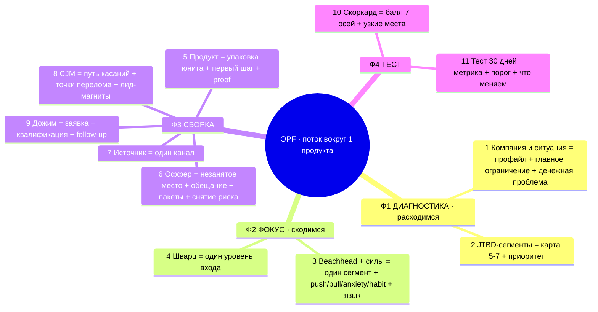

# One Product Flow — карта этапов «что делаем → что получаем»

> **Задача метода — собрать воронку одного продукта (первое касание → покупка).** Быстрый обзор всей последовательности. По ней за 2 секунды видно: какие этапы проходим и что клиент получает от каждого. Полная версия с движками-скилами → [method-canonical-v3](method-canonical-v3-2026-07-06.md). Прогон по шагам-файлам → [steps/](steps/_index.md).

## Майнд-карта



## Что получаем от каждого этапа

| Этап | Что делаем | Что получаем |
|---|---|---|
| 1 Компания и ситуация | собираем факты + ставим диагноз | контекст + **главное ограничение** + денежная проблема |
| 2 JTBD-сегменты | раскладываем на работы | карта 5-7 сегментов + приоритет |
| 3 Beachhead + силы | выбираем один, разбираем что движет | один сегмент + push/pull/anxiety/habit + язык клиента |
| 4 Шварц | выбираем момент входа | один уровень осознанности |
| 5 Продукт | собираем под сегмент | упаковка юнита, первый шаг, proof |
| 6 Оффер | позиционируем и обещаем | незанятое место + оффер + пакеты + снятие риска |
| 7 Источник | выбираем один канал | где сегмент уже есть |
| 8 CJM | рисуем путь касаний | точки перелома + лид-магниты по шагам |
| 9 Дожим | собираем обработку | заявка, квалификация, follow-up |
| 10 Скоркард | меряем зрелость | балл 7 осей + узкие места |
| 11 Тест | запускаем проверку | метрика, порог, что меняем |

## Разговорная версия (для рассказа за 2 секунды)

Четыре фразы — по одной на фазу:

1. **Диагностика.** «Сначала подробно разбираем компанию и текущую ситуацию: где именно теряешь деньги — главное ограничение и денежная проблема — и карту, кто у тебя вообще покупает.»
2. **Фокус.** «Выбираем ОДИН сегмент, у кого болит сильнее всего, разбираем что им движет и на каком уровне их ловить.»
3. **Сборка.** «Под них собираем продукт, оффер (и чем отстраиваемся от конкурентов), один канал, путь клиента и дожим.»
4. **Тест.** «Меряем зрелость по 7 осям и запускаем один 30-дневный тест с чёткой метрикой.»

Финал: **на выходе — один продукт, один сегмент, один вход, один источник, один проверяемый поток.**

## Одна строка (совсем быстро)

```text
компания/ситуация → ограничение → сегменты → 1 сегмент + силы → уровень
→ продукт → оффер (+ незанятое место) → источник → CJM → дожим → 7 осей → тест
```
